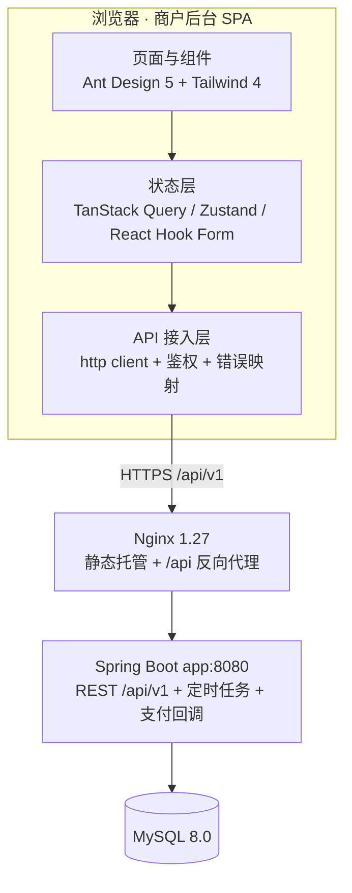

# 美容院轻量 SaaS 系统 · 商户后台前端技术文档（BTD）

> 版本：v1.0（首版）
>
> 状态：评审中
>
> 最后更新：2026-11-18
>
> 关联文档：README-PRD.md（产品需求文档）、README-PTD.md（项目技术文档）、README-BTD.md（后端服务技术文档，待补）
>
> 适用范围：商户后台 Web（React 19 + TypeScript + Ant Design 5 + Tailwind CSS 4），**不含**顾客端（Taro 小程序 / H5）
>
> 适用读者：前端开发、测试、联调后端、AI 编码助手

> **命名澄清**：本文件中的「BTD」指**商户后台前端**技术文档；PRD/PTD 第 1.3 节引用的 `README-BTD.md` 指**后端服务**技术文档。两者需分别维护，避免混用。

### 阅读导航

| 你是 | 建议阅读顺序 |
|---|---|
| 前端开发（接手实现） | §3 选型 → §4 工程架构 → §6 状态 → §7 API → §8 业务规则 → §9 日历 → §10 页面 |
| 测试 | §10 页面 → §13.4 验收要点 → §18.2 开放问题（口径未定项） |
| 后端联调 | §7.5 接口清单 → §7.4 业务码 → §7.6 并发冲突 → §18.2 开放问题 |
| 产品 / 评审 | §1 概述 → §11 权限 → §17 里程碑 → §18 风险与开放问题 |
| 排期 / 交付 | §17 里程碑 → §13.5 质量门槛 → §15 部署 |

---

## 1. 概述

### 1.1 文档目标

把 PRD 的业务规则与 PTD 的技术约束，落成一份可直接排期、可直接编码、可直接验收的**商户后台前端实现说明**。读完本文应能回答：

- 商户后台有哪些页面、每个页面对应 PRD 的哪条功能与角色权限；
- 前端如何接入 `/api/v1` 契约，如何处理 `{ code, message, data }`、鉴权、并发冲突与幂等；
- PRD 的硬规则（24 小时提前量、2 小时支付超时、分币金额、Asia/Shanghai、状态机）在界面上如何表达与被守住；
- 桌面日历优先的排班/库存视图怎么建模、怎么渲染、怎么保证不误操作；
- 怎么发、怎么观测、怎么按里程碑交付。

### 1.2 与 PRD / PTD 的边界

| 文档 | 定义内容 | 本文的引用方式 |
|---|---|---|
| PRD | 角色、核心闭环、业务规则、验收标准、范围外事项 | 引用条款编号，不复制原文；标注落地方式 |
| PTD | 技术选型、数据模型、状态机、并发幂等、API 概览、部署与测试策略 | 作为**约束**遵循，前端只在必要处补充实现细节 |
| 本文（BTD-前端） | 前端架构、路由与权限、状态与数据流、API 接入规范、页面级交互设计、日历视图实现、质量门槛、交付计划 | 只讲「前端怎么做」，不下沉到后端实现 |

**不重复的原则**：业务规则原文归 PRD；后端状态机与库存扣减实现归 PTD/后端 BTD；本文只写「前端依赖什么、展示什么、拦住什么、失败怎么兜」。

### 1.3 关键前提与假设

以下事项 PRD/PTD 未完全明确，本文按此假设落笔，并已登记在 [§18.2 开放问题](#182-开放问题待决策)：

| 编号 | 假设 |
|---|---|
| A1 | 商户后台为**单页应用（SPA）**，由 Nginx 托管静态资源，`/api` 反向代理到 Spring Boot（PTD §8） |
| A2 | 登录态由 Sa-Token 颁发，前端通过 `Authorization` 请求头携带（与后端 `sa-token.token-name` 一致） |
| A3 | 演示环境为**单商户单门店**，前端不做门店切换器；`merchant_id` 由服务端从登录态推导，前端不传 |
| A4 | 支付为模拟支付（PTD §2.1），商户后台**不承载支付收银台**，只展示支付状态与倒计时 |
| A5 | 顾客确认核销发生在顾客端；商户后台需能展示「等待顾客确认」并支持管理员代确认（PRD §5.3、§3） |
| A6 | 排班保存后由后端同步生成 `slot_inventory`，前端只负责录入窗口与展示生成结果 |
| A7 | 目标浏览器：Chrome / Edge 最近 2 个大版本；最小可用宽度 1280px（桌面优先，PRD §9） |

---

## 2. 系统定位与前端上下文

### 2.1 商户后台在系统中的位置

要点：

- 前端**只**与 `/api/v1` 通信，不直连数据库、不感知支付平台回调细节。
- 静态资源与 API 同域（Nginx 同源反代），因此**不需要跨域配置**，也不使用 Cookie 跨站携带，避免 CSRF 面扩大。
- 库存与状态机的最终裁决在服务端（PTD §5.1、§5.4），前端**不做预占、不做本地扣减**。

### 2.2 前端运行约束

| 约束 | 来源 | 前端应对 |
|---|---|---|
| 中文界面 | PRD §9 | `antd` 使用 `zh_CN` locale，文案表统一中文（标点、术语见 §12.5） |
| 桌面日历优先 | PRD §9、PTD §3 | 登录后落地页为日历；日历页占据全宽内容区，不套窄容器 |
| 时区固定 Asia/Shanghai | PRD §6、PTD §3 | 全局 dayjs 固定时区，禁止使用浏览器本地时区做业务判断 |
| 金额一律为「分」的整数 | PRD §6、§8.5 | 传输与计算全部使用整数分；仅在展示层转元（§8.1） |
| 读接口 P95 < 500ms，写 < 1s | PRD §9 | 单页路由级分包、请求并行、列表不串行补数据、日历按可见范围取数 |
| 多租户预留、单租户演示 | PRD §9 | 前端不含租户切换，但所有列表/详情均以服务端返回的 `merchantId` 为准，不做本地缓存跨账号复用 |
| 角色 STAFF / ADMIN | PRD §3 | 路由级 + 按钮级双层守门（§11） |

### 2.3 前端职责边界

**前端负责**：录入与校验（格式、必填、时间窗口合法性）、规则的可视化提示（不可预约原因、倒计时、取消时限）、防误操作（二次确认、状态前置校验、防重复提交）、失败兜底（冲突提示 + 刷新）、权限可见性。

**前端不负责**（由服务端兜底，前端只做最佳努力提示）：库存是否足够、预约状态是否允许流转、退款金额计算、跨商户越权拦截、幂等去重的最终保证。**任何前端校验都必须假设会被绕过**，服务端仍是唯一事实来源。

### 2.4 前端术语补充

| 术语 | 说明 |
|---|---|
| 槽位（slot） | `slot_inventory` 的一行，对应「某资源 + 某日期 + 某开始时间」的可售单元 |
| 泳道（lane） | 日历视图中按资源横向排列的一行，一个资源一条泳道 |
| 服务端状态 | 来源于接口、需要缓存与失效管理的数据（TanStack Query 管理） |
| 客户端状态 | 仅存在于界面的状态（表单草稿、抽屉开关、筛选器暂存） |
| 余量 | `total - used`，由服务端返回，前端不自行累加跨接口数据 |
| 业务码 | 响应体 `code` 字段，用于区分「已登录但业务被拒」与「未登录」 |

---

## 3. 技术选型

### 3.1 选型总表

| 类别 | 选型 | 版本 | 用途 | 备注 |
|---|---|---|---|---|
| 语言 | TypeScript | 5.9+ | 全量类型化 | 开启 `strict`、`noUncheckedIndexedAccess` |
| 框架 | React | 19.x | UI 运行时 | 与 PTD §3 一致 |
| 构建 | Vite | 7.x | 开发与构建 | 路由级代码分割 |
| UI 组件 | Ant Design | 5.2x | 表格、表单、日期、弹层、反馈 | React 19 需 `@ant-design/v5-patch-for-react-19` |
| 图标 | `@ant-design/icons` | 6.x | 图标 | 按需导入，禁止整包 |
| 样式 | Tailwind CSS | 4.x | 布局、间距、设计令牌落地 | PTD §3 强制；与 antd 分层共存（§3.3） |
| 路由 | React Router | 7.x | 路由与数据加载 | `createBrowserRouter` + 懒加载 |
| 服务端状态 | TanStack Query | 5.x | 请求缓存、失效、轮询 | 不把接口数据放进 Redux |
| 客户端状态 | Zustand | 5.x | 登录态、UI 偏好 | 仅放轻量、非服务端数据 |
| 表单 | React Hook Form + Zod | 7.x / 4.x | 表单状态与校验 | Schema 复用为类型来源 |
| 时间 | dayjs（`utc`/`timezone`/`duration` 插件） | 1.11+ | 时区、格式化、时长 | 与 antd 日期组件共用同一实例 |
| 质量 | ESLint 9（flat）+ Prettier 3 | — | 规范与格式 | `lint-staged` + `pre-commit` |
| 观测 | Sentry（`@sentry/react`） | 11.x | 异常与性能 | 脱敏后上报 |
| 包管理 | pnpm | 11.x | 依赖管理 | 锁定 `pnpm-lock.yaml` |

### 3.2 选型决策

| 决策 | 选择 | 理由 | 备选与放弃原因 |
|---|---|---|---|
| 组件库与样式 | **Ant Design 5 出组件 + Tailwind 4 出布局与令牌** | 后台重度依赖表格/表单/日期/弹层，antd 开箱即用；Tailwind 承担设计令牌与页面布局，满足 PTD §3 的样式要求 | 纯 Tailwind 自建组件：表单/表格/日历交互需重复造轮子，工期不可控；纯 antd：无法满足 PTD 令牌化要求且定制受限 |
| 服务端状态 | TanStack Query | 缓存、失效、轮询、并发去重天然契合「库存随时变化」场景 | Redux Toolkit：样板代码多，仍需手写缓存失效；Zustand 管接口数据会导致跨页同步易错 |
| 客户端状态 | Zustand（persist 仅登录态最小字段） | 体量小、无 Provider 嵌套、可在拦截器中读写 | Context：拦截器与路由守卫读取不便 |
| 日历视图 | **自建网格**（CSS Grid + 绝对定位槽位） | 业务形态固定（资源 × 时间轴），自建可精确控制锁定态、余量与权限；包体小 | FullCalendar：体积大、样式改造成本高、与 antd 视觉割裂；antd Calendar：仅日期粒度，无法表达时段库存 |
| 表单校验 | React Hook Form + Zod | 无受控重渲染负担；Schema 同时产出类型，减少 DTO 重复定义 | antd Form 内建校验：跨字段（时长/窗口/容量）规则表达弱，类型推导有限 |
| 金额处理 | 整数「分」+ 展示层格式化 | 直接对齐 PRD §6/§8.5，杜绝浮点 | decimal.js：引入额外依赖，且与契约不一致 |
| 接口类型 | 以 apifox 契约为准**手写 DTO 层 + 运行时挑选关键字段校验** | 后端 BTD 未定稿，生成器噪音大；手写层可在契约变更时集中修正 | openapi-typescript 自动生成：待契约稳定后作为增强手段（§7.8） |

### 3.3 版本兼容与已知坑

| 风险点 | 说明 | 处置 |
|---|---|---|
| React 19 + antd 5 | antd 5 对 React 19 的静态方法（`message`/`notification`/`Modal`）存在兼容问题 | 引入 `@ant-design/v5-patch-for-react-19`，并在 M0 验证 `App.useApp()` 用法 |
| Tailwind 4 + antd 样式冲突 | ①antd 样式由 CSS-in-JS 运行时注入，属于**无层样式**，按层叠层规则优先于 `@layer` 内的任何 Tailwind 工具类（与选择器权重无关）；②Tailwind preflight 重置会干扰 antd 组件内部元素 | ①需要覆盖 antd 的类（如 `.ant-layout` 的 `min-height: 0`）时，把规则写在 `@layer` **之外**并用双类选择器提权，不要依赖 `min-h-screen` 等工具类；②冲突验证（按钮、输入框、表格、弹层），必要时启用 Tailwind `prefix(tw)` |
| Tailwind 4 配置形态 | v4 采用 CSS-first 配置，`tailwind.config.js` 不再是唯一入口 | 令牌集中在单一 CSS 入口的 `@theme` 中定义，并与 antd `ConfigProvider.theme.token` 保持同源 |
| antd 与 dayjs 双实例 | 多版本 dayjs 会导致 locale 与时区插件失效 | 依赖提升策略固定单版本，并在 `pnpm.overrides` 锁定 |
| 图标整包引入 | `@ant-design/icons` 全量引入体积巨大 | 仅命名导入实际使用的图标；构建后校验 chunk 体积 |

---

## 4. 工程架构

### 4.1 分层

普通后台管理系统的常规分层，四层各自职责单一，调用方向自上而下。

| 层 | 目录 | 职责 | 约束 |
|---|---|---|---|
| 应用层 | `layouts/`、`router/`、`App.tsx` | 应用外壳、路由表、登录与角色守卫 | 只做装配，不写业务逻辑 |
| 页面层 | `pages/<模块>/` | 组装页面、承接路由参数、编排交互 | 数据一律经模块 hooks + `api/`，不直接写 `fetch` |
| 通用层 | `components/`、`hooks/`、`stores/` | 可复用的组件、hooks 与全局状态 | 不引用任何 `pages/` 内容 |
| 基础设施 | `api/`、`utils/`、`constants/`、`config/`、`types/`、`styles/` | 接口定义、工具函数、枚举与字典、环境配置、类型、主题 | 不依赖上层 |

**调用约定**：页面 → 模块内的 `hooks.ts`（React Query 查询/变更）→ `api/` 接口函数 → `http` 实例。金额、时间、权限等判定统一走 `utils/`，页面内不重复实现。

### 4.2 目录结构

采用后台管理系统通用结构，按「技术类型」分目录、页面按业务模块内聚。

| 路径 | 职责 |
|---|---|
| `src/api/` | 接口层：`http.ts`（实例、超时、鉴权头）、`errors.ts`（`AppError` 与业务码归一）、`queryClient.ts`（QueryClient 与 query key 工厂），以及按模块拆分的接口文件（已实现 `auth.ts`、`staff.ts`，后续按里程碑补充 `service.ts`、`resource.ts`、`schedule.ts`、`calendar.ts`、`reservation.ts`、`deposit.ts`、`role.ts`、`audit.ts`、`dashboard.ts`） |
| `src/assets/` | 静态资源：空态插画、图标、品牌图 |
| `src/components/` | 公共组件：`PageHeader`、`MoneyText`、`DurationText`、`StatusTag`、`QueryBoundary`、`DangerConfirm`、`PlaceholderPage` |
| `src/config/` | 环境配置：`env.ts`（读取并校正 `VITE_*` 变量，导出 `env` 与 `isProduction`） |
| `src/constants/` | 常量与字典：`permissions.ts`（角色权限矩阵）、`status.ts`（状态文案与颜色）、`constants.ts`（分页尺寸、轮询间隔、时间粒度） |
| `src/hooks/` | 通用 hooks：`usePermission`、`useUrlQueryState`、`useDebouncedValue`、`useOnlineStatus` |
| `src/layouts/` | 布局：`AppLayout`（左侧导航 + 顶栏 + 内容区）、`BlankLayout`（登录页） |
| `src/pages/` | 页面，按业务模块分目录，见 4.2.1；`pages/error/` 放 403 / 404 / 路由错误页 |
| `src/router/` | `index.tsx`（路由表与懒加载）、`guards.tsx`（`RequireAuth`、`RequireRole`）、`routes.tsx`（`ROUTE_META`，导航与路由共用的元信息） |
| `src/stores/` | 全局状态：`session.ts`（token、当前用户、角色，含 http 鉴权绑定） |
| `src/styles/` | `index.css`（Tailwind 入口与 `@theme` 令牌）、`theme.ts`（antd token） |
| `src/types/` | 全局类型：`api.ts`（`ApiResponse`、分页）、`domain.ts`（状态枚举、`StatusMeta`、时段状态） |
| `src/utils/` | 工具：`money.ts`（分↔元）、`datetime.ts`（时区与格式化）、`status.ts`（状态派生与可操作判定）、`permission.ts`（权限判定）、`format.ts`（脱敏等）、`observability.ts`（Sentry 按需初始化） |
| `src/App.tsx` / `src/main.tsx` | 应用入口：Provider 装配、路由挂载 |

**4.2.1 页面模块的约定**

`pages/<模块>/` 内部按需增删，不强制四件套；简单页面一个 `index.tsx` 即可。

| 文件/目录 | 何时需要 |
|---|---|
| `index.tsx` | 必有，页面入口（默认导出，供路由懒加载） |
| `components/` | 该模块专用组件较多时（如 `SlotDrawer`、`ScheduleForm`） |
| `hooks.ts` | 该模块有 2 个以上查询/变更时，集中 query key 与失效 |
| `schema.ts` | 表单校验规则较多时，集中 Zod Schema |

### 4.3 页面模块与 PRD 功能映射

| 模块目录 | PRD 功能（§4.2） | 可见角色 |
|---|---|---|
| `pages/login` | 员工登录 | 公开 |
| `pages/dashboard` | 工作台概览（派生自日历与预约） | STAFF / ADMIN |
| `pages/calendar` | 时段与库存：日历视图、手动锁定/释放 | STAFF / ADMIN |
| `pages/schedule` | 排班管理：按资源按日设置可售窗口 | STAFF / ADMIN |
| `pages/service` | 服务管理：增删改查、上下架 | STAFF（只读）/ ADMIN |
| `pages/resource` | 资源管理：技师/床位增删改查 | STAFF / ADMIN |
| `pages/reservation` | 预约：列表、详情、核销、取消；管理员代客下单 | STAFF / ADMIN（下单与退款仅 ADMIN） |
| `pages/deposit` | 定金流水查询 | STAFF（只读）/ ADMIN |
| `pages/staff` | 员工管理：账号、姓名、状态、重置密码（角色固定 STAFF） | ADMIN |
| `pages/role` | 角色管理：角色字典与权限矩阵 | ADMIN |
| `pages/audit` | 关键操作留痕（PRD §9 可观测） | ADMIN |

> 说明：PRD §3 角色表未明确「员工是否可查看定金流水」。本文按「STAFF 只读、不可导出」落地，已在 §18.2 登记待确认。

### 4.4 路由与信息架构

| 路径 | 页面 | 权限 | 懒加载 | 说明 |
|---|---|---|---|---|
| `/login` | 登录 | 公开 | 否 | 已登录访问则重定向首页 |
| `/` | 重定向 | — | — | 登录后落地 `/calendar`（PRD §9 日历优先） |
| `/calendar` | 日历 / 时段库存 | STAFF / ADMIN | 是 | 支持 `?date=&view=day\|week=&resourceIds=` |
| `/schedules` | 排班管理 | STAFF / ADMIN | 是 | 支持 `?dateFrom=&dateTo=&resourceId=` |
| `/reservations` | 预约列表 | STAFF / ADMIN | 是 | 支持 `?status=&dateFrom=&dateTo=&keyword=&page=` |
| `/reservations/:id` | 预约详情 | STAFF / ADMIN | 是 | 抽屉与独立页共用同一视图组件 |
| `/services` | 服务项目 | STAFF（只读）/ ADMIN | 是 | 只读态隐藏写操作按钮 |
| `/resources` | 资源管理 | STAFF / ADMIN | 是 | 删除/停用需二次确认并展示影响面 |
| `/deposits` | 定金流水 | STAFF / ADMIN | 是 | 支持 `?status=&dateFrom=&dateTo=&reservationNo=` |
| `/staff` | 员工 | ADMIN | 是 | 员工账号维护；角色固定为员工 |
| `/roles` | 角色 | ADMIN | 是 | 角色字典与权限矩阵（当前只读） |
| `/audit-logs` | 审计日志 | ADMIN | 是 | 只读 |
| `/403` `/404` `/500` | 状态页 | 公开 | 否 | 与错误边界联动 |

**路由约定**

1. 所有列表筛选条件写进 **URL query**（`useUrlQueryState`），保证刷新、分享、返回时视图一致。
2. 页面级懒加载统一 `import()` + 路由 `lazy`，公共依赖（antd 基础、Query）留在主 chunk。
3. 未知路径落 `404`；已登录但无权限落 `403` 而非跳回首页，避免用户误以为路由不存在。

### 4.5 环境与配置

| 变量 | 示例 | 用途 |
|---|---|---|
| `VITE_API_BASE_URL` | `/api/v1` | 接口前缀（同域反代，默认相对路径） |
| `VITE_APP_ENV` | `dev` / `staging` / `prod` | 环境标识，用于日志与 Sentry 环境 |
| `VITE_SENTRY_DSN` | — | 异常上报，留空则不上报 |
| `VITE_POLL_INTERVAL_MS` | `30000` | 日历与预约列表的轮询间隔 |
| `VITE_SLOT_GRAIN_MINUTES` | `15` | 日历时间轴粒度（15/30） |
| `VITE_APP_VERSION` | `1.0.0` | 版本号，随产物注入并在错误上报中携带 |

**约定**：前端环境变量**只能**包含非敏感配置；任何密钥、支付参数、数据库信息均不得进入前端构建产物（`VITE_` 前缀变量会被打包进客户端）。

### 4.6 构建与产物

| 项 | 约定 |
|---|---|
| 构建命令 | `pnpm build`（`tsc --noEmit` 校验后 `vite build`） |
| 产物目录 | `dist/` |
| 资源路径 | `base: '/'`，与 Nginx 根路径一致；如后续挂子路径需同步调整 |
| 分包 | 路由级分包 + vendor 拆分为 `react`、`antd`、`query`、`dayjs` 四组 |
| 哈希与缓存 | 文件名带 content hash，`index.html` 不缓存（见 §15.1） |
| Source map | 生产生成 `hidden` source map，仅上传 Sentry，不随静态产物发布 |

---

## 5. 设计系统与界面规范

### 5.1 设计令牌

令牌集中定义在一处，并**双向映射**：Tailwind 的 `@theme` 供布局样式使用，antd 的 `ConfigProvider.theme.token` 供组件使用，两者取同一份值，避免「两套色板」。

| 令牌组 | 令牌 | 默认值 | 用途 |
|---|---|---|---|
| 品牌 | `color-primary` | 待设计定稿（暂用 antd 默认蓝，可覆盖） | 主按钮、选中态、链接 |
| 品牌 | `color-primary-hover` / `-active` | 由主色派生 | 交互态 |
| 中性 | `color-bg-page` | `#F7F8FA` | 页面底色，衬托卡片与日历网格 |
| 中性 | `color-bg-container` | `#FFFFFF` | 卡片、抽屉、面板 |
| 中性 | `color-border` / `-split` | antd 灰阶 | 分隔线、表格线 |
| 文本 | `color-text-primary` / `-secondary` / `-disabled` | antd 灰阶 | 三级文本 |
| 语义 | `color-success` | 绿 | 已完成、可售 |
| 语义 | `color-warning` | 橙 | 退款中、临近时限、余量紧张 |
| 语义 | `color-error` | 红 | 已满、失败、危险操作 |
| 语义 | `color-info` | 蓝/青 | 待支付、已确认 |
| 字体 | `font-family` | 系统中文栈（PingFang SC / Microsoft YaHei 回退） | 全站 |
| 字号 | `font-size-12/14/16/20/24` | 12/14/16/20/24 | 辅助/正文/小标题/标题/页标题 |
| 间距 | `space-4/8/12/16/24/32` | 4px 基准 | 布局节奏 |
| 圆角 | `radius-sm/md/lg` | 4/6/8 | 卡片 8、控件 6 |
| 阴影 | `shadow-card` / `-popup` | 轻/中 | 卡片浮起、弹层 |
| 层级 | `z-base/sticky/dropdown/modal/toast` | 0/10/1000/1100/1200 | 统一 z-index，禁止魔法数字 |

**令牌纪律**：页面与组件内**禁止硬编码颜色与间距**，一律使用令牌；新增令牌需在设计令牌表中登记后再使用。

### 5.2 组件分层

| 层 | 来源 | 说明 | 举例 |
|---|---|---|---|
| 基础组件 | antd | 不二次封装能直接用的组件 | `Button`、`Table`、`DatePicker`、`Drawer` |
| 业务无关组件 | `components/` | 解决跨模块复用与一致性 | `StatusTag`、`MoneyText`、`PageHeader`、`QueryBoundary`、`DangerConfirm` |
| 模块组件 | `pages/<模块>/components/` | 承载模块语义，只在本模块复用 | `SlotCell`、`ResourceLane`、`ReservationTimeline`、`ScheduleForm` |
| 页面 | `pages/<模块>/index.tsx` | 组装与编排，不放业务计算 | `calendar/index.tsx`、`reservation/index.tsx` |

**统一封装要求**：`StatusTag`（状态→颜色/文案单一来源）、`MoneyText`（分→元，含千分位）、`DurationText`（分钟→`1小时30分钟`）、`DangerConfirm`（危险操作二次确认，含影响面说明）、`QueryBoundary`（加载/空/错误三态统一）。

### 5.3 布局规范

| 区域 | 规范 |
|---|---|
| 应用外壳 | 左侧导航（展开 232px / 折叠 64px，可记忆偏好）+ 顶栏 56px + 内容区 |
| 顶栏内容 | 面包屑、当前页刷新、用户菜单（角色展示、退出登录） |
| 内容区 | 默认最大宽度 1600px 居中，左右内边距 24px；**日历页取消最大宽度约束**，横向铺满 |
| 列表页 | `PageHeader`（标题 + 主操作）+ 筛选卡片 + 表格卡片，表格统一 `size="middle"`、固定表头、右侧操作列固定 |
| 详情页 | 左内容 + 右侧操作栏（宽度 320px），操作栏随滚动吸顶 |
| 抽屉 | 日历内的槽位/预约详情用抽屉（宽度 480px），不打断日历上下文 |

### 5.4 中文与本地化

| 项 | 规范 |
|---|---|
| 语言 | 全部简体中文；无中英混排（技术名词如「SKU」不出现在界面） |
| 日期 | `YYYY-MM-DD`；日历表头 `MM-DD 周X` |
| 时间 | `HH:mm`（24 小时制）；区间写作 `09:00–12:00`（使用连接号） |
| 金额 | `¥1,280.00`；列表内紧凑显示 `¥1280`，详情与流水显示两位小数 |
| 时长 | `90分钟`、`1小时30分钟`、`2小时` |
| 周起始 | 周一（`zh_CN` 默认，显式确认） |
| 数字 | 千分位分隔；库存显示 `已用 1/2` 形式 |
| 空值 | 统一 `—`，不使用 `null`/`undefined`/空白 |

### 5.5 响应式与可用宽度

| 宽度 | 行为 |
|---|---|
| ≥ 1440px | 完整三栏（导航 + 内容 + 详情侧栏） |
| 1280–1439px | 导航自动折叠为图标；日历泳道数多时横向滚动 |
| 1024–1279px | 仅保证核心页（日历、预约列表）可用；表格允许横向滚动 |
| < 1024px | 展示「请使用桌面端访问以获得完整排班体验」提示页，不提供功能降级实现 |

移动端适配不在第一期范围（PRD §9 明确后台桌面优先）。

### 5.6 可用性与无障碍

- 所有交互控件具备键盘可达性（antd 默认满足），自定义日历槽位需支持 `Tab` 聚焦与 `Enter` 打开。
- 颜色不作为唯一状态标识：状态徽标必须带文字（如「已满」而非只变色）。
- 正文文本对比度 ≥ 4.5:1；日历槽位内文字在浅色底上使用深色文本。
- 危险操作使用红色仅作强调，必须配文字说明后果。

---

## 6. 状态管理与数据流

### 6.1 状态分类与归属

| 状态类型 | 举例 | 存放位置 | 说明 |
|---|---|---|---|
| 服务端状态 | 服务列表、资源、排班、日历数据、预约列表/详情、流水、员工、审计 | TanStack Query | 统一缓存、失效、轮询；**不复制进 Zustand** |
| 会话状态 | token、当前用户、角色 | Zustand（persist 最小集） | 仅持久化 token 与用户摘要 |
| 表单状态 | 服务表单、排班表单、筛选表单草稿 | React Hook Form | 提交成功后重置或关闭 |
| 视图状态 | 抽屉开关、选中槽位、日历视图模式 | 组件本地 `useState` 或 URL | 可分享的筛选放 URL |
| URL 状态 | 日期、视图、筛选、分页 | 路由 query | 唯一事实来源，避免刷新丢状态 |

**判定规则**：数据来自接口 → Query；数据要跨页面共享且非接口 → Zustand；只在当前页面活着 → 本地 state；希望刷新/分享后仍存在 → URL。

### 6.2 Query Key 规范

统一使用「资源名 + 参数对象」的数组结构，参数对象键按固定顺序排列，保证序列化稳定。

| 资源 | Key 结构 | 失效触发 |
|---|---|---|
| 当前会话 | `['session','me']` | 登录/登出/角色变更 |
| 今日概览 | `['dashboard','today',date]` | 核销、取消、锁定/释放 |
| 日历 | `['calendar',{date,view,resourceIds,serviceId}]` | 锁定/释放、核销、取消、排班变更、轮询 |
| 单资源时段 | `['slots',{date,resourceId}]` | 同上 |
| 服务列表 | `['services',{keyword,status,page,size}]` | 服务增删改、上下架 |
| 服务详情 | `['services','detail',id]` | 服务更新 |
| 资源列表 | `['resources',{type,status}]` | 资源增删改、停用 |
| 排班区间 | `['schedules',{resourceId,dateFrom,dateTo}]` | 排班增删改（同时失效 `calendar`） |
| 预约列表 | `['reservations',{status,dateFrom,dateTo,resourceId,serviceId,keyword,page,size}]` | 下单、核销、取消、轮询 |
| 预约详情 | `['reservations','detail',id]` | 核销、取消 |
| 定金流水 | `['deposits',{status,dateFrom,dateTo,reservationNo,page,size}]` | 取消/退款、轮询 |
| 员工列表 | `['staff',{keyword,page,size}]` | 员工新增/编辑/删除、重置密码 |
| 角色矩阵 | `['roles']` | 角色权限变更（当前只读，接口就绪后启用） |
| 审计日志 | `['audit',{action,dateFrom,dateTo,operatorId,page,size}]` | 手动刷新 |

### 6.3 缓存与刷新策略

| 数据 | `staleTime` | 轮询 | 理由 |
|---|---|---|---|
| 服务 / 资源 / 员工 / 角色 | 5 分钟 | 无 | 低频变更，人工操作即可 |
| 排班区间 | 2 分钟 | 无 | 变更后主动失效 |
| 日历 / 槽位 | 30 秒 | 页面可见时 30 秒；隐藏时暂停 | 库存随他人下单变化，需准实时 |
| 预约列表 | 30 秒 | 页面可见时 60 秒 | 新预约与顾客确认会改变列表 |
| 预约详情 | 10 秒 | 页面可见时 15 秒（等待顾客确认期间 5 秒） | 核销存在跨端确认 |
| 定金流水 | 60 秒 | 页面可见时 60 秒 | 支付/退款状态异步推进 |
| 今日概览 | 60 秒 | 60 秒 | 聚合数据，容忍轻微延迟 |

**统一约束**：`refetchOnWindowFocus` 开启（回到页面即校准）；分页列表 `placeholderData` 保留上一页数据避免闪白；轮询在页面不可见时暂停（`refetchIntervalInBackground: false`）。

### 6.4 变更后失效清单

| 变更操作 | 必须失效 | 说明 |
|---|---|---|
| 服务新增/编辑/上下架/删除 | `services`、`calendar` | 服务时长变化会影响槽位展示粒度 |
| 资源新增/编辑/停用 | `resources`、`calendar`、`schedules` | 停用资源需从日历泳道移除 |
| 排班新增/编辑/删除 | `schedules`、`calendar`、`slots` | 后端同步生成/调整库存 |
| 时段锁定/释放 | `calendar`、`slots`、`dashboard` | 锁定影响可售状态 |
| 创建预约（代客下单） | `reservations`、`calendar`、`deposits`、`dashboard` | 占用库存并产生流水 |
| 核销 | `reservations`、`reservations detail`、`calendar`、`dashboard` | 状态与占用变化 |
| 取消/退款 | `reservations`、`reservations detail`、`calendar`、`deposits`、`dashboard` | 释放库存 + 流水状态 |
| 员工新增/编辑/停用/删除 | `staff`、`session me` | 停用或删除当前账号会使其立即失去权限 |
| 角色权限变更 | `roles`、`session me` | 重建菜单与守卫，避免继续显示旧权限 |

### 6.5 乐观更新边界

| 操作 | 是否乐观 | 说明 |
|---|---|---|
| 时段锁定 / 释放 | 是 | 视觉即时反馈；失败则回滚并提示「时段状态已变化，已刷新」 |
| 服务上下架 | 是（仅切换开关） | 失败回滚开关 |
| 资源停用 | 否 | 可能影响未来排班，需等待服务端结果并展示影响数 |
| 核销 / 取消 / 退款 | **否** | 涉及资金与状态机，必须等待服务端确认后刷新 |
| 排班保存 | 否 | 需展示「生成 N 个槽位」的服务端结果 |

---

## 7. API 接入层

### 7.1 统一响应与错误模型

后端统一返回 `{ code, message, data }`（PTD §6）。前端采用**双层判定**：

| 层 | 判定 | 处理 |
|---|---|---|
| 传输层 | HTTP 状态码 | 401/403 走鉴权与权限流程；5xx 走系统错误；网络异常走「网络不可用」 |
| 业务层 | `code !== 0` | 视为业务失败：取 `message` 作为兜底文案，再按业务码映射为具体动作（§7.4） |

约定：

- `code === 0` 时 `data` 为业务载荷；分页载荷统一 `{ list, total, page, size }`（字段名以后端契约为准，前端在 DTO 层做一次适配）。
- **不把 `message` 直接当唯一提示语**：已知业务码使用前端固定文案（便于统一措辞），未知码才透传 `message` 并附「请稍后重试或联系管理员」。
- 所有错误在接入层**归一为一个 `AppError`**（含 `kind`、`code`、`httpStatus`、`message`、`traceId`），页面层只处理 `kind`。

| 错误类别 `kind` | 触发 | 页面层动作 |
|---|---|---|
| `unauthorized` | HTTP 401 / 业务码未登录或凭证过期 | 清会话 → 跳登录页（带 `redirect` 回跳参数） |
| `forbidden` | HTTP 403 / 无权限 | 提示「无权限执行该操作」；页面级则渲染 403 |
| `notFound` | HTTP 404 | 详情页渲染「记录不存在或已被删除」 |
| `validation` | 参数校验失败（业务码或 422） | 定位到表单字段并展示字段级错误 |
| `conflict` | 库存不足、状态已变更（409 或对应业务码） | 弹「数据已变化」提示 + 自动刷新当前视图 |
| `business` | 其他业务拒绝（规则不允许） | Toast 展示领域文案，不刷新 |
| `network` / `timeout` | 断网、超时 | 断网提示条 + 「重试」按钮 |
| `server` | 5xx | 通用错误提示 + 上报 Sentry（含 `traceId`） |

### 7.2 鉴权与会话

| 项 | 约定 |
|---|---|
| 登录入口 | `POST /api/v1/auth/login`（仅校验身份、返回 token） |
| 凭证载体 | 请求头 `Authorization: <token>`（后端 `sa-token.token-name`），集中配置在 `config/env.ts` 的 `authHeader` |
| 用户信息 | 登录成功后立即调用 `GET /api/v1/auth/me` 获取昵称、角色、`merchantId`；登录接口不返回用户信息，避免两处数据不一致 |
| 存储位置 | 内存（Zustand 运行时）+ `sessionStorage`（仅持久化 token 与用户摘要，供刷新后恢复） |
| 为何不用 localStorage | 降低 XSS 长期驻留风险；关闭标签页即失效，配合后端 token 有效期足够；代价是新开标签页需重新登录（可接受） |
| 多标签页 | 使用 `BroadcastChannel` 广播「登出 / 角色变更」；同源新标签页首次加载若无会话则跳登录 |
| 401 处理 | 接入层统一拦截：清理会话、提示「登录已过期」、跳转 `/login?redirect=<当前路径>`；**并发多个 401 只处理一次**（去重锁） |
| 403 处理 | 不跳登录；按钮级提示，页面级渲染 403 页 |
| 登出 | 调用登出接口（失败也继续本地清理），清空 Query 缓存（`queryClient.clear()`）与 Zustand |
| 回跳 | 登录成功后仅接受站内相对路径，过滤 `//`、`http` 等外链，防开放重定向 |

### 7.3 请求规范

| 项 | 规范 |
|---|---|
| 实例 | 单一 http 客户端实例，统一 `baseURL = VITE_API_BASE_URL`、超时读 10s / 写 20s |
| 请求 ID | 每次请求生成 `X-Request-Id`（或用后端 `traceId`）并记入错误对象，便于与日志对齐 |
| 重试 | **仅幂等 GET** 自动重试 1 次（网络错误/5xx）；POST/PUT/PATCH/DELETE 一律不自动重试 |
| 取消 | 路由切换或参数变化时取消未完成请求（Query 自动管理 `AbortSignal`），避免兔笼竞态 |
| 参数序列化 | 日期统一 `YYYY-MM-DD`，时间 `HH:mm`，时间戳为服务端时区 ISO 字符串；`undefined` 参数不发送，空字符串转 `undefined` |
| 上传/下载 | 第一期仅需「流水导出」（若确认做）；下载走 `blob` 并按文件名保存，鉴权头同样携带 |
| 日志 | 开发环境输出方法/路径/耗时/业务码；生产仅上报异常，不打印响应体（含顾客手机号，属个人信息） |

### 7.4 业务码映射

> 与后端 `ErrorCode` 枚举一一对应（编码规则：5 位，前两位为 HTTP 语义，后三位为业务细分）。后端业务失败统一以 **HTTP 200 + `code !== 0`** 返回，因此 `code` 是唯一判定依据；映射集中在 `api/errors.ts`，禁止在页面里散落数字。

| 业务码 | 语义 | 前端 `kind` | 前端动作 |
|---|---|---|---|
| `0` | 成功 | — | 正常返回 |
| `40001` | 参数错误 | `validation` | 字段级错误提示 |
| `40101` | 未登录 / 登录失效 | `unauthorized` | 清会话跳登录；登录失败时展示后端文案（如「手机号或密码错误」） |
| `40301` | 无权限（含账号已禁用） | `forbidden` | 页面级 403 / 按钮级提示 |
| `40401` | 资源不存在 | `notFound` | 详情页渲染「记录不存在」 |
| `40901` | 时段已满 | `conflict` | 提示「该时段已约满」+ 刷新日历 |
| `40902` | 预约状态不允许该操作 | `conflict` | 提示「状态已变化」+ 刷新详情 |
| `40903` | 距服务开始不足 24 小时 | `business` | 提示不可取消，引导联系商户 |
| `40904` | 数据已存在 | `business` | 提示重复，不重复提交 |
| `50000` | 系统异常 | `server` | 通用失败提示 + 上报 |

**文案优先级**：同一个业务码可能承载不同场景（如 `40101` 既表示「登录失效」也表示「密码错误」），因此优先展示后端 `message`，缺失时才用上表的兜底文案。

### 7.5 商户端接口契约清单

> 统一前缀 `/api/v1`，除登录外均需鉴权，服务端按登录态强制隔离 `merchantId`（前端不传）。**认证部分已与后端实现对齐**，其余模块随里程碑推进逐步补齐。

**认证**（已实现）

| 方法 | 路径 | 用途 | 关键入参 | 关键出参 | 错误语义 |
|---|---|---|---|---|---|
| POST | `/auth/login` | 员工登录 | `phone`、`password` | `token`（**不含用户信息**） | `40101` 手机号或密码错误；`40301` 账号已禁用 |
| GET | `/auth/me` | 当前用户信息 | — | `userId`、`merchantId`、`phone`、`nickname`、`role`、`status` | `40101` 未登录；`40301` 账号已禁用 |
| POST | `/auth/logout` | 登出 | — | — | 幂等，失败不阻断前端清理 |

**字段约定（认证相关）**

| 项 | 约定 |
|---|---|
| 登录流程 | `login` 拿到 token → 写入会话 → 立即 `GET /auth/me` 取用户信息 → 写入会话 → 跳转；`/auth/me` 失败则回滚会话并提示 |
| ID 类型 | 后端 `Long` 全部序列化为**字符串**（`JacksonConfig`），前端一律按 `string` 处理，避免 JS 精度丢失 |
| 角色 | 后端返回 `CUSTOMER` / `STAFF` / `ADMIN`；商户后台只接受 `STAFF` / `ADMIN`，其他角色登录后提示无权限并清会话 |
| 显示名 | 优先 `nickname`，为空时回退 `phone` |

**服务项目**（ADMIN，待实现）

| 方法 | 路径 | 用途 | 关键入参 | 关键出参 | 错误语义 |
|---|---|---|---|---|---|
| GET | `/merchant/services` | 列表 | 关键词、状态、分页 | 列表、总数 | — |
| GET | `/merchant/services/{id}` | 详情 | — | 服务完整字段（名称、时长、价格、定金、状态） | 不存在 |
| POST | `/merchant/services` | 新增 | 名称、时长(分钟)、价格(分)、定金(分)、描述 | 新 ID | 名称重复；参数非法 |
| PUT | `/merchant/services/{id}` | 编辑 | 同上 | — | 不存在；被引用不允许改时长（待确认） |
| PATCH | `/merchant/services/{id}/status` | 上下架 | 目标状态 | — | 不存在 |
| DELETE | `/merchant/services/{id}` | 删除 | — | — | 存在未完成预约时拒绝 |

**资源**（写操作 ADMIN，读 STAFF/ADMIN）

| 方法 | 路径 | 用途 | 关键入参 | 关键出参 | 错误语义 |
|---|---|---|---|---|---|
| GET | `/merchant/resources` | 列表 | 类型(STAFF/ROOM)、状态 | 列表 | — |
| POST | `/merchant/resources` | 新增 | 名称、类型、备注 | 新 ID | 名称重复 |
| PUT | `/merchant/resources/{id}` | 编辑 | 同上 | — | 不存在 |
| PATCH | `/merchant/resources/{id}/status` | 启用/停用 | 目标状态 | 受影响排班/预约数 | 存在未完成预约时拒绝停用 |
| DELETE | `/merchant/resources/{id}` | 删除 | — | — | 有排班或预约时拒绝 |

**排班**

| 方法 | 路径 | 用途 | 关键入参 | 关键出参 | 错误语义 |
|---|---|---|---|---|---|
| GET | `/merchant/schedules` | 区间查询 | resourceId、dateFrom、dateTo | 排班列表（含容量、生成槽位数） | — |
| POST | `/merchant/schedules` | 新增窗口 | resourceId、日期、开始/结束时间、容量 | 排班 ID、**生成槽位数** | 时间窗非法；与既有排班重叠；与预约冲突 |
| PUT | `/merchant/schedules/{id}` | 编辑窗口 | 时间、容量 | 变更后槽位数 | 已有预约的时段不可直接缩短/删除 |
| DELETE | `/merchant/schedules/{id}` | 删除窗口 | — | — | 存在预约时拒绝，提示改为锁定 |

**日历与时段库存**

| 方法 | 路径 | 用途 | 关键入参 | 关键出参 | 错误语义 |
|---|---|---|---|---|---|
| GET | `/merchant/calendar` | 日历数据 | date、view(day/week)、resourceIds、serviceId | 按资源分组的槽位（时间、total、used、可售/锁定状态、关联预约摘要） | — |
| GET | `/merchant/slots` | 单资源时段明细 | date、resourceId | 槽位列表 | — |
| POST | `/merchant/slots/{id}/lock` | 锁定时段 | 备注（可选） | 最新槽位状态 | 已满/已锁定时幂等返回；冲突 |
| POST | `/merchant/slots/{id}/unlock` | 释放时段 | — | 最新槽位状态 | 无锁定时幂等返回 |
| POST | `/merchant/slots/lock-batch` | 批量锁定（第二期，视确认） | 槽位 ID 列表 | 成功/失败清单 | 部分冲突返回明细 |

**预约**

| 方法 | 路径 | 用途 | 关键入参 | 关键出参 | 错误语义 |
|---|---|---|---|---|---|
| GET | `/merchant/reservations` | 列表 | 状态、日期区间、资源、服务、关键词（预约号/手机号后四位）、分页 | 列表、总数 | — |
| GET | `/merchant/reservations/{id}` | 详情 | — | 预约全字段、支付流水摘要、状态时间线 | 不存在 |
| POST | `/merchant/reservations` | 代客下单（ADMIN） | 服务、资源、槽位、顾客手机号、备注、模拟支付开关 | 预约单、状态 | 库存不足；未达 24h 提前量；时段锁定 |
| POST | `/merchant/reservations/{id}/cancel` | 取消（幂等） | 原因、是否退款 | 最新状态、退款结果 | 状态不允许；已核销 |
| POST | `/merchant/reservations/{id}/checkin` | 发起核销（幂等） | 确认方式（顾客确认/商户代确认） | 最新状态 | 状态不允许；已核销（幂等） |

**定金流水**

| 方法 | 路径 | 用途 | 关键入参 | 关键出参 | 错误语义 |
|---|---|---|---|---|---|
| GET | `/merchant/deposits` | 列表 | 状态、日期区间、预约号、分页 | 流水列表（含金额分、支付/退款时间） | — |
| GET | `/merchant/deposits/{id}` | 详情 | — | 流水全字段、关联预约 | 不存在 |
| GET | `/merchant/deposits/summary` | 期间小计（可选） | 日期区间 | 收款/退款/净额（分） | — |

**员工**（ADMIN，后端已实现）

| 方法 | 路径 | 用途 | 关键入参 | 关键出参 | 错误语义 |
|---|---|---|---|---|---|
| GET | `/admin/staff` | 员工分页列表 | `page`、`size`、`keyword` | `records`、`total`、`page`、`size`、`pages` | — |
| GET | `/admin/staff/{id}` | 员工详情 | — | `id`、`phone`、`nickname`、`role`、`status`、`createdAt` | `40401` 不存在 |
| POST | `/admin/staff` | 新增员工 | `phone`、`password`、`nickname`、`status` | 员工信息 | `40001` 参数错误；`40904` 手机号重复 |
| PUT | `/admin/staff/{id}` | 编辑员工（局部更新） | `phone`、`nickname`、`status` | 员工信息 | `40401`；`40904` |
| DELETE | `/admin/staff/{id}` | 删除员工（逻辑删除） | — | — | `40401` |
| PUT | `/admin/staff/{id}/password` | 重置密码 | `newPassword`（6-32 位） | — | `40001`；`40401` |

> 员工角色固定为 `STAFF`，员工接口不接受角色字段；角色本身由**角色管理**独立维护。

**角色**（ADMIN，后端待实现）

| 方法 | 路径 | 用途 | 说明 |
|---|---|---|---|
| GET | `/admin/roles` | 角色列表 | 返回角色字典（`code`、`name`）及其权限点 |
| PUT | `/admin/roles/{code}` | 修改角色权限 | 待后端开放；前端当前只读展示常量矩阵 |

> 现状：后端仅有 `role` 字典表（`code`: `CUSTOMER` / `STAFF` / `ADMIN`），未开放维护接口。前端角色页按 `constants/permissions.ts` 的 `ROLE_PERMISSIONS` 只读展示，接口就绪后改为查询并支持编辑。

**审计日志**（ADMIN）

| 方法 | 路径 | 用途 | 关键入参 | 关键出参 | 错误语义 |
|---|---|---|---|---|---|
| GET | `/merchant/audit-logs` | 查询 | 动作类型、日期区间、操作人、分页 | 列表（动作、对象、操作人、时间、结果） | — |

**工作台**

| 方法 | 路径 | 用途 | 关键入参 | 关键出参 | 错误语义 |
|---|---|---|---|---|---|
| GET | `/merchant/dashboard/today` | 今日概览 | date（默认今天） | 今日预约数、待到店数、已完成数、今日定金收入（分）、余量紧张时段数 | — |

### 7.6 并发与冲突处理

| 场景 | 服务端行为 | 前端表现 |
|---|---|---|
| 两人同时锁定同一时段 | 条件更新，后到者失败 | 提示「该时段状态已变化」→ 自动刷新日历 → 保留用户当前位置与日期 |
| 顾客刚下单占满最后一个余量 | 返回库存不足 | 槽位立即置为「已满」，Toast 提示，不关闭用户已填写的表单 |
| 核销时预约已被他人核销 | 状态条件更新失败 | 提示「该预约已完成核销」→ 刷新详情并把操作区置为只读 |
| 排班保存与既有预约冲突 | 拒绝并返回冲突时段 | 冲突明细列表化展示（时间 + 资源 + 预约号），引导改为锁定 |
| 前端持有过期列表数据 | — | 所有写操作前不做「乐观相信」，以服务端结果为准；冲突一律「刷新再决定」 |

**核心原则**：前端不尝试用本地状态解决竞争，只做**冲突的可读化呈现 + 一键刷新**。

### 7.7 幂等与防重复提交

| 措施 | 适用 | 说明 |
|---|---|---|
| 按钮提交态禁用 + 文案变化（「核销中…」） | 所有写操作 | 基础防线 |
| 请求级去重 | 核销、取消、锁定/释放 | 同一资源同一操作在飞行中时直接复用同一 Promise |
| 幂等键 | 代客下单、核销、取消 | 请求头携带前端生成的幂等键（如 `Idempotency-Key`），是否启用以后端契约为准 |
| 结果码 `40904` 视为成功 | 重复操作 | 提示「操作已完成」并刷新，不显示红色错误 |
| 页面离开保护 | 表单未保存时 | 路由离开二次确认（仅表单脏数据场景） |

### 7.8 契约同步与类型

| 项 | 约定 |
|---|---|
| 契约来源 | Apifox 为唯一契约源（PTD §3）；前端在 DTO 层做**一次**字段适配 |
| 类型位置 | DTO 类型与接口函数同域存放；页面只消费 ViewModel，不直接吞 DTO |
| DTO → ViewModel | 统一在 `model.ts` 转换：金额字段归一为整数分、时间归一为 dayjs（Asia/Shanghai）、状态归一为枚举 |
| 运行时校验 | 对「决定业务分支」的关键字段（状态、槽位余量、金额）做轻量校验，缺失或非法时进入 `server` 错误通道并上报，避免界面出现 `undefined` |
| 契约变更流程 | 后端改契约 → Apifox 更新 → 前端 `types/` 与 `api/` 同步更新 → 联调确认后合并 |
| 后续增强 | 契约稳定后可引入 `openapi-typescript` 生成 DTO，替换手写层（不改变上层调用形态） |

---

## 8. 关键业务规则的前端落地

本章逐条对应 PRD §6 业务规则与 §8 验收标准，说明**界面如何表达**与**前端如何守住**。

### 8.1 金额（单位：分）

| 项 | 规范 |
|---|---|
| 传输与计算 | 全部使用整数分（`number`）；禁止任何除法参与业务计算 |
| 展示 | 统一经 `MoneyText` 转元：除以 100 后固定两位小数 + 千分位 + `¥` 前缀 |
| 输入 | 表单以「元」录入，字符串解析后转分（`parseYuanToFen`），**不经过浮点乘法**（按小数点切分整数部分与小数部分拼装）；限制最多两位小数 |
| 校验 | 定金 ≤ 价格；价格 > 0；定金 ≥ 0；两者均为整数分 |
| 汇总 | 期间小计直接对整数分求和，再一次性格式化，避免逐条格式化后再累加 |
| 禁止 | 使用 `toFixed` 参与后续计算；用 `parseFloat` 解析金额输入；把金额当字符串做比较 |

### 8.2 时间与时区

| 项 | 规范 |
|---|---|
| 时区 | 全局固定 `Asia/Shanghai`；dayjs 启用 `utc` + `timezone` 插件，统一通过 `datetime` 工具获取「当前时间」 |
| 判定基准 | 所有「距今多久」「是否满足 24 小时」的判定以**服务端返回的时间**为准（如 `serverTime` 或响应时间戳）；无服务端时间时用本地时间并接受少量偏差 |
| 展示 | 日期 `YYYY-MM-DD`，时间 `HH:mm`；跨天区间显示 `07-01 22:00 – 07-02 02:00` |
| 传输 | 日期字段 `YYYY-MM-DD`，时间字段 `HH:mm`，时间戳为带时区 ISO 字符串 |
| 禁止 | 使用 `new Date()` 直接参与业务判定；使用浏览器 `Intl` 本地时区格式化；用字符串比较时间戳 |
| 边界 | 排班窗口要求「开始 < 结束」；跨天营业（22:00–次日 02:00）**第一期不支持**，表单显式提示（见 §18.2） |

### 8.3 预约提前量（≥ 24 小时）

PRD §6：仅可预约「服务开始 ≥ 当前时间 + 24 小时」的时段。

| 触点 | 前端行为 |
|---|---|
| 日历槽位 | 开始时间距当前 < 24h 的槽位渲染为「不可预约」态（灰化 + 悬浮说明「需提前 24 小时预约」），仍可查看已存在的预约 |
| 代客下单表单 | 选择时段后立即校验；不满足则禁用提交并展示规则文案，不弹错误 Toast（避免「先让人填完再报错」） |
| 排班设置 | 允许为今天/明天设置排班（供到店直接核销等场景），但新增预约仍受 24h 约束；表单提示「该窗口内的时段在满足 24 小时提前量后才可被预约」 |
| 兜底 | 服务端仍会校验并返回对应业务码；前端按 `business` 处理并刷新槽位 |

### 8.4 待支付 2 小时倒计时

PRD §6、§8.3：待支付占位最长 2 小时，超时自动释放、预约单置为「已过期」。

| 项 | 规范 |
|---|---|
| 数据来源 | 以服务端返回的 `expiresAt`（或 `createdAt + 2h`）为准，**不在前端自行加 2 小时** |
| 展示 | 预约详情与列表对 `PENDING_PAYMENT` 显示倒计时 `剩余 1:58:31`；≤ 10 分钟转为警示色；≤ 0 显示「已超时」 |
| 更新 | 倒计时由本地秒级递减驱动（轻量定时器），仅在页面可见时运行；**不因此发起高频请求** |
| 到期处理 | 到期后触发一次详情刷新；若服务端已置为 `EXPIRED` 则更新界面并提示「已超时关闭，时段已释放」 |
| 兜底 | 定时任务每分钟扫描（PTD §5.3），前端展示可能存在 ≤ 1 分钟滞后，界面不承诺秒级精确 |

### 8.5 取消与退款

PRD §5.2、§6：服务前 ≥ 24h 可自助取消并全额退定金；< 24h 不可自助取消。

| 项 | 规范 |
|---|---|
| 自助取消入口 | 仅顾客端提供；商户后台的「取消」属于**商户取消**，需二次确认并说明影响（释放时段 + 按规则退款） |
| 权限 | 商户取消仅 ADMIN（PRD §3：员工无取消/退款权限） |
| 时限内判定 | 商户后台取消不做 24h 阻断（商户侧走售后），但需在确认弹窗中展示「距服务开始 X 小时」，让操作人有明确认知 |
| 确认内容 | 预约号、服务、资源、时间、定金金额、退款说明、是否保留顾客联系备注 |
| 结果展示 | 状态流转到 `REFUNDING` → 显示「退款处理中」，流水状态同步刷新；到 `REFUNDED` 后显示完成时间 |
| 禁用条件 | `COMPLETED`（已核销）、`CANCELLED`、`EXPIRED`、`REFUNDED` 状态下取消按钮不可见或禁用，并说明原因 |
| 文案 | 禁止使用「删除预约」，统一「取消预约」；退款相关文案不得承诺到账时间（演示环境仅记录状态） |

### 8.6 核销

PRD §5.3：商户发起核销 → 顾客确认（或商户代确认）→ 已核销。

| 环节 | 设计 |
|---|---|
| 入口 | 预约列表行操作、预约详情操作栏、日历槽位抽屉内操作 |
| 前置条件 | 仅 `CONFIRMED` 可发起；其他状态按钮禁用并给出原因 |
| 发起方式 | 「发起核销（等顾客确认）」→ 状态进入等待确认（若后端无独立状态则体现为 `CONFIRMED` + 确认标记，以后端契约为准） |
| 代确认 | 「代顾客确认并完成核销」仅 ADMIN 可见，需要二次确认并提示「将直接置为已完成」 |
| 等待态 | 详情页展示「等待顾客确认」并以 5 秒轮询刷新；提供「手动刷新」按钮 |
| 幂等 | 重复点击只发一次请求；服务端返回已核销时按重复提交处理（视为成功） |
| 成功后 | Toast「核销成功」→ 失效预约列表/详情/日历/概览；槽位占用与余量同步刷新 |
| 撤销 | 第一期不支持撤销核销（登记为开放问题 §18.2） |

### 8.7 排班 → 时段库存生成

PRD §5.4、PTD §5.6。

| 项 | 前端行为 |
|---|---|
| 录入项 | 资源、日期、开始时间、结束时间、容量（每槽位可容纳人数） |
| 预览 | 提交前根据「窗口时长 ÷ 服务时长或固定步长」**预估**槽位数并提示「预计生成 N 个时段，实际以保存结果为准」 |
| 保存反馈 | 使用服务端返回的「实际生成槽位数」展示结果，并给出「查看日历」入口（跳转带日期与资源筛选） |
| 冲突 | 与既有排班重叠、与既有预约冲突时，后端返回冲突明细；前端以列表呈现（时段 + 资源 + 关联预约号），并提示改为锁定 |
| 编辑限制 | 已产生预约的时段：不允许缩短/删除窗口，只允许锁定；前端在编辑弹窗内提示并把相关字段置为只读（以服务端校验为准） |
| 批量 | 批量/周模板排班为第二期候选（§18.2）；第一期按「单资源单日」录入，支持复制到次日/本周其余日（前端逐条提交并汇总结果） |

### 8.8 时段锁定与释放

PRD §4.1.5、§5.4.3。

| 项 | 规范 |
|---|---|
| 语义 | 锁定 = 暂停售卖（不删除库存、不影响已存在预约）；释放 = 恢复售卖 |
| 入口 | 日历槽位右键菜单 / 槽位抽屉按钮 / 日历工具栏批量（第二期） |
| 权限 | STAFF / ADMIN 均可（PRD §3） |
| 确认 | 锁定时可填备注（如「设备维修」）；释放无需备注 |
| 乐观更新 | 立即切换槽位视觉状态并显示 loading 叠层；失败回滚 + 提示刷新 |
| 已满时段 | 允许锁定（避免继续超卖语义歧义以外的情况），但需提示「该时段已有预约」 |
| 已存在预约的时段 | 锁定不取消既有预约，UI 明确提示 |

### 8.9 状态机与 UI 映射

**预约单状态**（PTD §5.4）

| 状态 | 中文 | 徽标颜色 | 允许的操作（ADMIN / STAFF） | 说明 |
|---|---|---|---|---|
| `PENDING_PAYMENT` | 待支付 | 蓝（processing） | 取消（ADMIN）/ 查看 | 显示 2 小时倒计时 |
| `CONFIRMED` | 已确认 | 青（cyan） | 核销 / 取消（ADMIN）/ 查看 | 显示「等待顾客确认」子态 |
| `COMPLETED` | 已完成 | 绿（success） | 查看 | 只读，展示核销时间与操作人 |
| `CANCELLED` | 已取消 | 灰（default） | 查看 | 展示取消原因与操作人 |
| `EXPIRED` | 已过期 | 灰（虚线边框） | 查看 | 超时未支付，展示过期时间 |
| `REFUNDING` | 退款中 | 橙（warning） | 查看 | 展示退款发起时间 |
| `REFUNDED` | 已退款 | 蓝紫（geekblue） | 查看 | 展示退款完成时间 |

**定金流水状态**（PTD §5.5）

| 状态 | 中文 | 徽标颜色 | 说明 |
|---|---|---|---|
| `PENDING` | 待支付 | 蓝 | 与预约待支付对应 |
| `SUCCESS` | 支付成功 | 绿 | 展示支付时间与支付单号 |
| `REFUNDED` | 已退款 | 蓝紫 | 展示退款时间 |
| `FAILED` | 支付失败 | 红 | 展示失败原因（脱敏） |
| `EXPIRED` | 已关闭 | 灰 | 超时关闭 |

**时段可售状态**（前端派生，用于日历渲染）

| 状态 | 判定 | 视觉 | 可操作 |
|---|---|---|---|
| 可售 | 未锁定 且 `used < total` | 白底、显示余量 `1/2` | 查看 / 锁定 |
| 已满 | 未锁定 且 `used >= total` | 浅红底、显示「已满」 | 查看 / 锁定 |
| 已锁定 | 锁定标记为真 | 斜纹灰底、显示「已锁定」+ 备注 | 查看 / 释放 |
| 不可预约 | 距开始 < 24h | 灰化、虚线 | 仅查看（不影响已存在预约） |
| 已过期 | 结束时间已过 | 极浅灰 | 仅查看 |

**状态与操作的一致性规则**：状态 → 可用操作由**单一映射表**（`constants/status.ts`）提供，页面不得各写一套 `if`；操作可用性 = 状态映射 ∧ 角色权限，**任一不满足即不渲染按钮**（而非仅禁用），并在需要解释时提供悬浮原因。

**跨端可见子态**：`CONFIRMED` 下存在「已发起核销、等待顾客确认」的子态。前端以服务端返回的字段（如 `checkinRequestedAt` / `pendingConfirm`）判定，不自行推测。

---

## 9. 日历与时段库存视图

日历是商户后台的核心页面（PRD §9「桌面日历优先」），也是复杂度最高的部分，单独成章。

### 9.1 视图形态

| 视图 | 结构 | 用途 | 上线批次 |
|---|---|---|---|
| 日视图（默认） | 纵轴时间（按粒度）+ 横向资源泳道 | 排班执行、锁定、查看某资源某时段占用 | M3 |
| 周视图 | 横轴 7 个日期，每格内按资源分组纵向排列 | 快速扫视一周余量与缺口 | M3（先做简化版） |
| 列表补充 | 当日预约清单（按开始时间排序） | 与日历并排，快速定位预约单 | M4 |

默认打开「今日 + 日视图」；日期与视图模式写入 URL（`?date=&view=`），支持前一天/后一天/回今天快捷切换与日期选择器直接跳转。

### 9.2 数据装配模型

日历数据从 `/merchant/calendar` 一次性取回「可见范围」内的槽位，前端在内存中装配为泳道模型：

| 模型字段 | 来源 | 说明 |
|---|---|---|
| `laneKey` | 资源 ID | 泳道唯一标识 |
| `laneTitle` | 资源名称 + 类型 | 展示 `1号床（床位）`、`Lisa（技师）` |
| `slotId` | 槽位 ID | 操作主键 |
| `startMinutes` / `endMinutes` | 开始/结束时间换算为当日分钟数 | 定位与高度计算，避免运行时反复解析时间 |
| `total` / `used` / `available` | 库存字段 | `available = total - used`，仅用于展示，不与服务端冲突判定 |
| `locked` / `lockNote` | 锁定标记与备注 | 渲染锁定样式与悬浮提示 |
| `reservations` | 关联预约摘要 | 抽屉内展示顾客、服务、状态，不在网格内展示顾客手机号 |
| `derivedState` | 派生 | 可售 / 已满 / 已锁定 / 不可预约 / 已过期（§8.9） |

**装配规则**：按 `laneKey` 分组 → 组内按 `startMinutes` 升序 → 计算同一泳道内的重叠布局（见 9.3）。装配结果做一次浅比较缓存，槽位未变化时不触发重渲染。

### 9.3 渲染

| 项 | 规范 |
|---|---|
| 时间轴粒度 | 默认 15 分钟（可配置 30）；表头每 60 分钟标注一次，避免文字拥挤 |
| 时间轴范围 | 由当日最早排班开始时间与最晚结束时间决定，前后各留 30 分钟留白；无排班时显示空态 |
| 槽位定位 | `top = (startMinutes - axisStart) / grain × rowHeight`；`height = (endMinutes - startMinutes) / grain × rowHeight`，最小高度不小于 28px 以保证可点击 |
| 重叠处理 | 同泳道内时间重叠的槽位（不同容量窗口/异常数据）横向并排，按重叠簇计算列宽；若后端保证同资源不重叠，则保留此逻辑作为兜底 |
| 泳道宽度 | 固定 160px，泳道数 ≥ 6 时支持横向滚动；泳道表头吸附在左侧（sticky） |
| 当前时间线 | 一条横向细线标示「现在」，仅在查看今日时显示，每分钟更新位置 |
| 视觉编码 | 底色表示可售状态、左侧 3px 色条表示可售/已满/锁定、文字显示 `已用/总量`；不使用纯色块区分状态（§5.6 无障碍） |
| 状态更新动效 | 锁定/释放仅做 150ms 底色过渡，不做位移动画，避免误读 |

### 9.4 交互

| 交互 | 行为 |
|---|---|
| 点击槽位 | 打开右侧抽屉：时段信息、余量、关联预约列表、锁定/释放、跳转预约详情 |
| 右键槽位 | 上下文菜单：锁定 / 释放 / 复制时段信息 |
| 悬浮槽位 | Tooltip：`09:00–10:00 · 已用 1/2 · 可预约`，锁定态追加备注 |
| 拖选（可选） | 仅用于「批量锁定」范围选择，第二期；第一期不做拖拽改期（PRD §6：不支持改约） |
| 日历工具栏 | 日期切换、视图切换、资源筛选（多选）、服务筛选、刷新按钮、最后更新时间 |
| 键盘 | 方向键在槽位间移动焦点，`Enter` 打开抽屉，`Esc` 关闭抽屉 |
| 深链 | 支持从排班保存结果、概览卡片跳转并预置日期与资源筛选 |

### 9.5 性能

| 场景 | 措施 |
|---|---|
| 泳道数量 | ≤ 20 条泳道直接渲染；> 20 条启用横向窗口化（仅渲染可视区域泳道） |
| 时间行数 | 15 分钟粒度 × 16 小时 ≈ 64 行，无需纵向虚拟化；若粒度改为 5 分钟，改为背景网格绘制而非逐格 DOM |
| 请求 | 一次请求取回一天全部资源，不按资源逐个请求；切换日期取消上一个未完成请求 |
| 重渲染 | 泳道组件按 `laneKey` 做 memo；槽位组件按 `slotId + derivedState + available` 做 memo；抽屉打开不引发整表重渲染 |
| 轮询 | 30 秒轮询仅刷新日历数据（不刷新整个路由），可见性切换时暂停 |
| 大数据日 | 单日槽位预计 < 500，若超过 1000 触发告警日志并降级为「按资源懒加载」 |

### 9.6 空态、错误与刷新

| 场景 | 表现 |
|---|---|
| 当日无排班 | 空态插画 + 「去设置排班」主按钮（跳 `/schedules?date=当天`） |
| 当日无资源 | 空态提示「暂无可用资源」+ 管理员可见「去新增资源」 |
| 加载中 | 骨架网格（保持泳道表头与时间轴可见，减少布局跳动） |
| 加载失败 | 保留上一次数据 + 顶部错误条 + 「重试」；完全无数据时展示错误空态 |
| 数据被他人改变 | 轮询静默更新；若用户正在操作某槽位，不打断，仅在提交时按冲突处理 |
| 数据陈旧提示 | 显示「更新于 10:32:05」；超过 2 分钟未更新时按钮变为「立即刷新」强调态 |

---

## 10. 页面级详细设计

每页统一按「目标 → 布局 → 交互与规则 → 接口 → 权限与边界」描述。全局通用项（加载/空/错误、确认弹窗、文案）见 §12，不逐页重复。

### 10.1 登录页 `/login`

| 项 | 说明 |
|---|---|
| 目标 | 员工/管理员进入后台（PRD §4.2 账号） |
| 布局 | 居中卡片（宽 400px）：品牌区 + 账号 + 密码 + 登录按钮 + 版本号；右侧（≥1440px）可放品牌插画 |
| 交互与规则 | 回车提交；提交中禁用按钮；错误文案区分「账号或密码错误」「账号已停用」；连续失败不锁定（演示环境）；成功后按 `redirect` 回跳，否则进 `/calendar` |
| 接口 | `POST /auth/login`、`GET /auth/me` |
| 权限与边界 | 已登录访问 `/login` 自动跳首页；不提供「找回密码」自助入口（第一期，文案引导联系管理员） |

### 10.2 工作台 `/dashboard`

| 项 | 说明 |
|---|---|
| 目标 | 一屏掌握今日经营概况，作为非日历优先用户的入口 |
| 布局 | 顶部 4 个指标卡（今日预约数、待到店、已完成、今日定金收入）+ 下方两栏：今日时段余量紧张列表、待确认/待支付清单 |
| 交互与规则 | 指标卡点击跳转带筛选的列表/日历；定金收入用整数分汇总后格式化；数据 60 秒轮询 |
| 接口 | `GET /merchant/dashboard/today`、复用 `reservations`、`calendar` |
| 权限与边界 | STAFF / ADMIN 均可见；不展示顾客手机号全量（脱敏为 `138****1234`） |

### 10.3 日历页 `/calendar`（核心）

| 项 | 说明 |
|---|---|
| 目标 | 以日历为主视角完成「看排班 → 看余量 → 锁定/释放 → 进入预约处理」 |
| 布局 | 工具栏（日期/视图/资源与服务筛选/刷新/最后更新时间）+ 日历网格（全宽）+ 右侧抽屉（槽位详情） |
| 交互与规则 | 详见 §9；切换日期走 URL；锁定需确认并可选备注；槽位抽屉内可直接打开预约详情抽屉；无排班时引导去排班 |
| 接口 | `GET /merchant/calendar`、`POST /merchant/slots/{id}/lock`、`POST /merchant/slots/{id}/unlock`、`GET /merchant/resources`、`GET /merchant/services` |
| 权限与边界 | STAFF / ADMIN 均可锁定/释放；不提供改期、拖拽调整（PRD §6 不支持改约） |

### 10.4 排班管理 `/schedules`

| 项 | 说明 |
|---|---|
| 目标 | 为资源设置某日可售窗口，并确认系统生成的时段库存 |
| 布局 | 筛选（日期区间 + 资源）+ 排班列表（按日期分组，组内按资源排序）+ 右侧「新增/编辑排班」抽屉 |
| 交互与规则 | 表单：资源、日期、开始、结束、容量；校验开始<结束、同资源同日不重叠（后端最终校验）；保存后展示「已生成 N 个时段」并给「查看日历」入口；删除前检查是否已有预约，有则拒绝并提示改为锁定（§8.7） |
| 接口 | `GET/POST/PUT/DELETE /merchant/schedules`、`GET /merchant/resources` |
| 权限与边界 | STAFF / ADMIN 可维护排班（PRD §3 管理资源与排班）；跨天窗口第一期不支持 |

### 10.5 服务项目 `/services`

| 项 | 说明 |
|---|---|
| 目标 | 维护服务项目（名称、时长、价格、定金）与上下架状态 |
| 布局 | `PageHeader`（新增）+ 筛选（关键词/状态）+ 表格（名称、时长、价格、定金、状态开关、更新时间、操作） |
| 交互与规则 | 新增/编辑用右侧抽屉表单；时长以 15 分钟为步进，影响时段拆分粒度；价格与定金以「元」录入并转分存储；上下架为开关，需确认并提示「下架后顾客端不再展示，既有预约不受影响」；删除需二次确认，存在未完成预约时禁用并解释 |
| 接口 | `GET /merchant/services`、`POST/PUT /merchant/services`、`PATCH /merchant/services/{id}/status`、`DELETE /merchant/services/{id}` |
| 权限与边界 | 读：STAFF / ADMIN（PRD §3 授予员工「浏览服务项目」）；写：仅 ADMIN（增删改、上下架）；价格与定金的修改在界面上标注「不影响已创建预约」 |

### 10.6 资源管理 `/resources`

| 项 | 说明 |
|---|---|
| 目标 | 维护技师与床位两类资源 |
| 布局 | Tab（技师 / 床位）+ 列表（名称、类型、状态、备注、操作） |
| 交互与规则 | 类型创建后不可修改（避免历史排班语义漂移）；停用需确认并展示「受影响排班数/未来预约数」（以接口返回为准）；存在未完成预约时禁止删除 |
| 接口 | `GET/POST/PUT /merchant/resources`、`PATCH /merchant/resources/{id}/status`、`DELETE /merchant/resources/{id}` |
| 权限与边界 | 读与写均为 STAFF / ADMIN（PRD §3 授予员工「管理资源与排班」）；删除资源需二次确认并展示受影响排班与预约数 |

### 10.7 预约列表 `/reservations`

| 项 | 说明 |
|---|---|
| 目标 | 检索与处理预约（查看、核销、取消） |
| 布局 | 筛选（状态多选、日期区间、资源、服务、关键词）+ 快捷 Tab（待支付 / 待服务 / 待确认 / 已完成 / 已取消）+ 表格（预约号、顾客、服务、资源、时间、定金、状态、操作）+ 分页 |
| 交互与规则 | 表格固定表头、操作列固定右侧；行点击进详情；行内「核销」「取消」按状态与权限显示；批量核销不做（避免误操作，登记为开放问题）；默认筛选「今日起 7 天 + 未结束状态」；页码与筛选同步 URL |
| 接口 | `GET /merchant/reservations`、`POST /merchant/reservations/{id}/checkin`、`POST /merchant/reservations/{id}/cancel` |
| 权限与边界 | STAFF：查看 + 核销；ADMIN：另可取消、代客下单（§3）；手机号脱敏展示 |

### 10.8 预约详情 `/reservations/:id`

| 项 | 说明 |
|---|---|
| 目标 | 单笔预约的完整视图与操作中心 |
| 布局 | 左：基本信息卡（预约号、状态、服务、资源、服务时间、金额、备注、顾客脱敏信息）+ 状态时间线；右：操作栏（核销、取消、刷新）+ 定金流水摘要 |
| 交互与规则 | 时间线按「创建 → 支付 → 确认 → 核销/取消」呈现时间与操作人；待支付显示倒计时（§8.4）；等待顾客确认时显示等待态并 5 秒轮询；操作按钮由状态映射表驱动（§8.9） |
| 接口 | `GET /merchant/reservations/{id}`、`checkin`、`cancel`、`GET /merchant/deposits?reservationNo=` |
| 权限与边界 | 只读字段不允许在后台编辑（改约不支持，PRD §6）；`COMPLETED` 全页只读 |

### 10.9 核销

| 项 | 说明 |
|---|---|
| 目标 | 到店确认服务完成 |
| 布局 | 复用预约详情操作栏 + 确认弹窗；不在日历内做「一键核销」 |
| 交互与规则 | 见 §8.6；确认弹窗展示预约号、顾客、服务、金额与服务时间；两种模式（发起等待顾客确认 / 代确认完成，后者 ADMIN）；成功后 Toast + 列表/详情/日历联动刷新 |
| 权限与边界 | STAFF / ADMIN 可发起（PRD §3）；代确认仅 ADMIN；不支持撤销（开放问题） |

### 10.10 定金流水 `/deposits`

| 项 | 说明 |
|---|---|
| 目标 | 查询定金收取与退款记录，支持对账 |
| 布局 | 筛选（状态、日期区间、预约号）+ 期间小计（收款 / 退款 / 净额）+ 表格（流水号、预约号、金额、状态、支付时间、退款时间）+ 分页 |
| 交互与规则 | 金额全部经 `MoneyText`；小计由服务端返回或前端对当前页汇总并在表头标注「当前页」避免误读；行点击展开关联预约摘要 |
| 接口 | `GET /merchant/deposits`、`GET /merchant/deposits/{id}`、`GET /merchant/deposits/summary`（可选） |
| 权限与边界 | STAFF 只读、ADMIN 只读 + 导出（导出待确认，§18.2）；不提供手动改流水状态 |

### 10.11 员工管理 `/staff`（已实现）

| 项 | 说明 |
|---|---|
| 目标 | 管理员维护员工账号：手机号（登录账号）、姓名、启用状态、密码（PRD §4.2） |
| 布局 | 搜索栏（姓名/手机号）+ 表格（姓名、手机号、状态开关、创建时间、操作）+ 新增/编辑抽屉 + 重置密码弹窗 |
| 数据流 | **分页查询统一走 hook**：`useStaffListParams()`（分页/关键字与 URL 双向同步）+ `useStaffPageQuery(params)`（`useQuery` + `keepPreviousData`）；变更走 `useCreateStaff` / `useUpdateStaff` / `useDeleteStaff` / `useResetStaffPassword`，成功后失效 `['staff']` |
| 交互与规则 | 手机号校验 `1[3-9]` 开头 11 位且全库唯一；密码 6-32 位，仅新增与重置时可填；编辑为局部更新（不填即不改）；状态开关可直接启停，**停用需二次确认**并说明「无法登录、历史数据不受影响」；删除为逻辑删除并二次确认；删除本页最后一条时自动回退一页；翻页保留上一页数据避免闪白 |
| 接口 | `GET/POST /admin/staff`、`PUT/DELETE /admin/staff/{id}`、`PUT /admin/staff/{id}/password`（§7.5） |
| 分页约定 | 后端 `total/page/size/pages` 为字符串（Long 序列化），在 `api/staff.ts` 归一为数字后交给页面；页面只消费 `PageResult<T>` |
| 权限与边界 | 仅 ADMIN（`staff:manage`）；不展示密码任何形态；**角色不在此页维护**，员工角色固定为 `STAFF` |

> 关于「不允许停用自己」：员工列表只包含 `role = STAFF` 的记录，而能进入本页的账号必为 `ADMIN`，因此天然不满足，无需额外按钮级拦截。

### 10.12 角色管理 `/roles`

| 项 | 说明 |
|---|---|
| 目标 | 维护商户后台的角色及其可用权限，与员工账号解耦 |
| 布局 | 角色表：角色（名称 + code）、说明、可用权限标签；后续增加「编辑权限」抽屉 |
| 交互与规则 | 当前为只读：角色与权限矩阵来自 `constants/permissions.ts`，与 PRD §3 一致；后端提供角色接口后改为查询 + 编辑，并即时刷新当前用户菜单 |
| 接口 | 规划为 `GET /admin/roles`、`PUT /admin/roles/{code}`（后端待实现，见 §7.5） |
| 权限与边界 | 仅 ADMIN（`role:manage`）；不允许删除内置角色（`STAFF` / `ADMIN`）；修改角色权限不得让当前操作人失去 `role:manage`，否则先提示再执行 |

### 10.13 审计日志 `/audit-logs`

| 项 | 说明 |
|---|---|
| 目标 | 满足 PRD §9「关键操作写审计日志」的可查性 |
| 布局 | 筛选（动作类型、日期区间、操作人）+ 表格（时间、操作人、动作、对象、结果、详情） |
| 交互与规则 | 只读；动作类型下拉固定枚举（下单、核销、取消、退款、锁定、释放、排班变更、服务变更）；详情以抽屉展示结构化字段；不支持导出（第一期） |
| 接口 | `GET /merchant/audit-logs` |
| 权限与边界 | 仅 ADMIN |

### 10.14 状态页与错误边界

| 页面/场景 | 表现 |
|---|---|
| 403 | 说明「当前账号无此页面权限」，提供「返回日历」与「切换账号」 |
| 404 | 说明「页面或记录不存在」，提供返回入口 |
| 路由级异常 | 错误边界兜底页 + 错误 ID（`traceId`）+ 「重试」+「返回首页」 |
| 组件级异常 | 局部错误占位（不白屏），上报 Sentry |
| 接口 5xx | 页面保留骨架/上次数据，顶部错误条 + 重试 |
| 离线 | 顶栏常驻提示「网络已断开」，恢复后自动重试失败查询 |

---

## 11. 权限模型

### 11.1 能力矩阵

以 PRD §3 为准，落到前端「路由 + 按钮 + 字段」三级。

| 能力 | STAFF | ADMIN | 前端落点 |
|---|---|---|---|
| 浏览服务项目 | ✅（只读） | ✅ | 路由可见，写操作按钮按 `service:write` 隐藏 |
| 管理服务项目（增删改、上下架） | — | ✅ | 按钮权限 `service:write` |
| 管理资源与排班 | ✅ | ✅ | `resource:write`、`schedule:write` |
| 查看日历 / 预约列表 | ✅ | ✅ | 路由权限 |
| 手动锁定 / 释放时段 | ✅ | ✅ | `slot:lock` |
| 发起核销 | ✅ | ✅ | `reservation:checkin` |
| 代顾客确认核销 | — | ✅ | `reservation:checkin:force` |
| 取消预约 / 申请退款 | — | ✅ | `reservation:cancel` |
| 创建预约 + 支付定金（代客下单） | — | ✅ | `reservation:create` |
| 查询定金流水 | ✅（只读） | ✅ | 路由权限 |
| 员工管理 | — | ✅ | `/staff` + `staff:manage` |
| 角色管理 | — | ✅ | `/roles` + `role:manage` |
| 审计日志 | — | ✅ | `/audit-logs` |

### 11.2 实现方式

| 层级 | 做法 |
|---|---|
| 路由级 | 路由 `handle.roles` 声明允许角色；`RequireAuth` + `RequireRole` 守卫，不满足跳 `/403`（已登录）或 `/login`（未登录） |
| 菜单级 | 导航菜单由「路由表 ∩ 当前用户角色」派生，**不渲染**无权限项（避免点了才报错） |
| 按钮级 | `usePermission()` 返回布尔；无权限一律不渲染按钮；需要解释时（如列表内空位）用禁用态 + Tooltip 说明原因 |
| 字段级 | 敏感字段（手机号）按角色脱敏；金额字段对所有后台角色可见 |
| 角色来源 | 以 `GET /auth/me` 的返回为唯一来源，**不信任本地缓存里的角色**；每次应用启动与角色变更后刷新 |
| 失效处理 | 收到 403 时刷新会话；若角色已变更则重建菜单与守卫（避免继续显示旧权限菜单） |

### 11.3 安全要点

| 项 | 做法 |
|---|---|
| 越权防护 | 前端只做可用性收敛；所有数据隔离依赖服务端按登录态拼 `merchant_id`（PTD §7），前端**不传** `merchant_id` |
| 凭证 | token 存 `sessionStorage`，不写 URL、不写日志、不写 Sentry 上下文 |
| XSS | 不使用 `dangerouslySetInnerHTML`；富文本字段（备注）按纯文本渲染；CSP 由 Nginx 下发（§15.1） |
| 敏感信息 | 顾客手机号默认脱敏；不缓存顾客信息到持久化存储；错误上报前脱敏（§13.1） |
| 依赖安全 | CI 执行依赖审计（`pnpm audit` 或等价），高危项阻断合并 |
| 开放重定向 | 登录回跳仅允许站内相对路径 |
| 剪贴板/导出 | 导出与复制操作记录到前端行为日志（§13.2），便于追溯 |

---

## 12. 交互规范与反馈

### 12.1 加载、空态、错误态

| 场景 | 规范 |
|---|---|
| 首屏加载 | 骨架屏，结构与最终布局一致（避免 CLS） |
| 列表加载 | 首次骨架行；翻页/筛选保留上一页数据并叠加 loading（`placeholderData`），不出现整页闪白 |
| 表格空 | 空态插图 + 一句原因 + 一个主操作（如「新增服务项目」） |
| 筛选无结果 | 提示「没有符合条件的数据」+「清空筛选」 |
| 抽屉/弹窗内加载 | 内容区骨架，标题与关闭按钮常驻 |
| 局部刷新 | 仅刷新区域显示 loading，不使用全屏遮罩 |
| 错误 | 见 §7.1 错误类别与页面动作 |

### 12.2 表单规范

| 项 | 规范 |
|---|---|
| 布局 | 抽屉内单列；字段 ≤ 8 个；标签右对齐固定宽度 96px |
| 校验时机 | 失焦校验单字段 + 提交时全量校验；输入中不即时报错（金额与时间除外，允许即时提示） |
| 必填标记 | 必填字段前红色星号；非必填字段在占位符说明「选填」 |
| 错误呈现 | 字段下方红字 + 提交失败时滚动/聚焦到首个错误字段；服务端字段级错误映射到对应字段 |
| 危险字段 | 价格/定金修改时提示「不影响已创建预约」；时间窗口变更提示「可能影响已生成时段」 |
| 离开保护 | 表单有未保存修改时，关闭抽屉/切换路由二次确认 |
| 提交反馈 | 提交按钮 loading + 文案变化；成功后关闭抽屉 + Toast + 列表刷新；失败保留输入 |

### 12.3 危险操作

| 操作 | 确认方式 | 文案要求 |
|---|---|---|
| 取消预约（含退款） | `DangerConfirm` 弹窗 | 展示预约号、服务、时间、定金金额、退款说明；主按钮「确认取消」 |
| 代顾客确认核销 | `DangerConfirm` | 明确「将直接置为已完成，定金计入结算」 |
| 删除服务/资源 | 弹窗 + 需输入名称后确认（仅删除） | 说明对既有预约的影响；被引用时禁用并解释 |
| 停用资源/下架服务 | 确认弹窗 | 说明影响范围（受影响排班数、未来预约数） |
| 锁定有时段预约的槽位 | 确认弹窗 | 说明「不取消既有预约，仅暂停新预约」 |
| 重置员工密码 | 确认弹窗 | 说明「将以新密码覆盖，请及时告知员工」 |

### 12.4 反馈通道使用边界

| 通道 | 使用场景 | 禁止 |
|---|---|---|
| `message`（轻提示） | 操作成功、可自愈的失败（已刷新） | 长篇解释、需要用户决策的内容 |
| `notification` | 后台类结果（批量操作汇总、导出完成） | 每次点击都弹 |
| 内联错误条 | 页面级加载失败、数据陈旧 | 与 Toast 重复提示同一错误 |
| 弹窗 | 需要确认或阻断 | 仅用于告知 |
| 抽屉 | 保留上下文的详情/编辑 | 承载需要全屏宽度的表格 |

**同一次失败只提示一次**：接入层不弹提示（只抛错），由页面统一决定呈现方式，避免「接口报错弹三次」。

### 12.5 文案规范

| 项 | 规范 |
|---|---|
| 术语一致 | 预约单、时段、余量、核销、定金、排班、资源（技师/床位）；不混用「订单/库存/打卡」 |
| 标点 | 中文全角标点；数字与中文之间不加空格；金额与单位不加空格（`¥128.00`） |
| 语气 | 陈述事实 + 给出下一步；避免「操作失败」这类无信息文案，改为「该时段已约满，已为你刷新日历」 |
| 时间 | 「服务开始前 24 小时」而非「T-24h」 |
| 状态词 | 与 §8.9 状态表完全一致，禁止同义词替换 |

---

## 13. 可观测与质量保障

### 13.1 异常上报（Sentry）

| 项 | 规范 |
|---|---|
| 上报内容 | 异常类型、堆栈、路由、`traceId`/`X-Request-Id`、业务码、环境、版本 |
| 脱敏 | 手机号、姓名、备注、token 一律不进入上报；请求体与响应体默认不上报 |
| 过滤 | 忽略已知无意义错误（用户取消请求、浏览器扩展注入错误） |
| 采样 | 生产错误 100%；性能采样 10% |
| Source map | `hidden` 模式生成并上传，公开发布产物中不含 map（§4.6） |
| 告警 | 5xx 与业务码 `5000` 触发阈值告警（按小时聚合） |

### 13.2 行为埋点

用于验证核心闭环与排查操作纠纷，字段统一为：动作名、对象类型、对象 ID、结果、耗时、失败原因分类、当前路由。**不含顾客个人信息**。

| 动作名 | 触发点 |
|---|---|
| `reservation.create` | 代客下单成功/失败 |
| `reservation.checkin` | 发起核销 / 代确认 |
| `reservation.cancel` | 取消预约 |
| `slot.lock` / `slot.unlock` | 锁定/释放 |
| `schedule.save` | 排班新增/编辑 |
| `service.status_change` | 上下架 |
| `session.login` / `session.logout` | 登录登出 |

> 说明：业务审计日志由后端写入 `audit_log`（PTD §4.1）；前端埋点仅用于体验与问题定位，二者不互相替代。

### 13.3 排查支持

| 项 | 规范 |
|---|---|
| 请求可追溯 | 每个错误对象携带 `traceId` 与 `X-Request-Id`，界面错误详情可复制 |
| 版本可见 | 登录页与应用外壳展示 `VITE_APP_VERSION`，便于对应用户反馈的版本 |
| 环境标识 | 非生产环境在顶栏显示环境角标（`STAGING`），避免误操作生产数据 |

### 13.4 验收要点

PRD §8 的五条验收标准主要落在后端并发与事务实现上，前端需保证「不自造数据、不掩盖异常、把服务端结论如实呈现」。联调与演示前按此表人工核对。

| PRD 条款 | 前端核对点 |
|---|---|
| §8.1 并发抢最后时段 | 下单失败时提示「该时段已约满」并刷新日历；刷新后余量为 0 且不出现重复预约行 |
| §8.2 支付回调幂等 | 流水列表对同一 `out_trade_no` 只展示一条成功记录；重复操作时按「已完成」提示而非报错 |
| §8.3 超时释放 | 待支付单倒计时归零后状态变「已过期」，对应时段恢复可售 |
| §8.4 取消退款 | 取消后状态依次为「退款中 → 已退款」，时段立即恢复可售 |
| §8.5 金额精度 | 服务价格、定金、流水、汇总全站两位小数，且与后端「分」值一致，无 0.01 级偏差 |

### 13.5 质量门槛（CI 阻断项）

| 项 | 门槛 |
|---|---|
| 类型检查 | `tsc --noEmit` 零错误，`strict` 开启 |
| Lint | ESLint 零 error；`no-explicit-any` 为 error |
| 格式 | Prettier check 通过 |
| 构建 | `pnpm build` 成功；主 chunk gzip 体积不超过预算（§14.2） |
| 依赖审计 | 无 high/critical 已知漏洞（或已登记豁免） |

---

## 14. 性能预算

### 14.1 指标目标

| 指标 | 目标 | 说明 |
|---|---|---|
| FCP | < 1.2s | 桌面端、演示环境常见网络 |
| LCP | < 1.8s | 首屏为日历骨架与工具栏 |
| INP | < 200ms | 槽位点击、抽屉打开、状态切换 |
| CLS | < 0.05 | 骨架与最终布局一致 |
| 路由切换 | < 300ms | 目标路由已预加载时 |
| 日历交互 | < 100ms | 单槽位状态切换视觉反馈 |
| 接口联动 | 读接口 P95 < 500ms、写 < 1s（PRD §9） | 前端不引入额外串行请求，列表不 N+1 |

### 14.2 体积与分包预算

> 下表「实测」为 M0 脚手架（React 19 + antd 5 + 日历占位页）的真实构建基线，预算按实测上浮 10% 设定；超出即视为回归。

| Chunk | gzip 预算 | 实测 | 说明 |
|---|---|---|---|
| 主包（react + router + query + 应用壳 + 基础 ui） | ≤ 125KB | ≈ 116KB | `react` 101 + `query` 9 + `index` 6 |
| antd 相关（含 icons 按需） | ≤ 210KB | ≈ 190KB | antd 5 + rc-* + cssinjs 的固定基线，非全量引入 |
| 单页 chunk | ≤ 60KB | < 1KB（占位页）、≈ 40KB（登录页含 Zod + RHF） | 常规页应保持在 60KB 以内 |
| dayjs + 插件 | ≤ 10KB | ≈ 7KB | 仅引入 `utc`、`timezone`、`duration`、`zh-cn` |

**首屏合计**：≈ 316KB gzip（不含登录页的 Zod/RHF，二者只在 `/login` 路由加载）。

### 14.3 优化手段

| 手段 | 说明 |
|---|---|
| 路由级懒加载 | 除登录与外壳外全部懒加载；日历作为落地页可预取 |
| 预取 | 鼠标悬停侧边菜单 150ms 后预取目标 chunk |
| 图标按需 | 命名导入具体图标；禁止 `import * as Icons` |
| 列表分页 | 统一页大小 20；不做前端全量拉取 |
| 请求并行 | 日历页的资源与服务字典并行请求；同一请求在组件间共享（Query 自动去重） |
| 缓存 | 静态资源长缓存 + 内容哈希（§15.1）；接口按 §6.3 缓存 |
| 字体 | 使用系统字体栈，不加载 Web Font，避免 FOUT 与额外体积 |
| 图片 | 空态插画用 SVG 内联组件，不用大图 |

### 14.4 监控与回归

- 每次发布后跑一次 Lighthouse（桌面、日历页与预约列表页）并记录基线。
- 体积超预算时 CI 输出明细对比，需在 PR 说明取舍理由后合并。
- 关键交互使用 Sentry 性能采样监控 P75，回归超过 20% 需排查。

---

## 15. 部署、构建与发布

### 15.1 Nginx 静态托管

| 项 | 配置要求 |
|---|---|
| 根路径 | SPA 路由 fallback：未命中静态文件时返回 `index.html`（`try_files $uri $uri/ /index.html`） |
| API 反代 | `/api` → `http://app:8080`（PTD §8），透传 `X-Request-Id` 与鉴权头，不做路径重写 |
| HTML 缓存 | `index.html`：`no-cache`（或极短缓存），保证发版即时生效 |
| 静态资源缓存 | 带 hash 的 `assets/*`：`public, max-age=31536000, immutable` |
| Source map | 构建产物含 `hidden` source map（`.map` 文件），Nginx 必须拒绝外部访问：`location ~* \.map$ { deny all; }`，map 仅上传 Sentry 使用 |
| 压缩 | 开启 gzip（js/css/json/svg），文本资源 ≥ 1KB 才压缩 |
| 安全响应头 | `Content-Security-Policy`（脚本仅自身域）、`X-Content-Type-Options: nosniff`、`X-Frame-Options: DENY`、`Referrer-Policy: strict-origin-when-cross-origin` |
| 超时 | 反向代理读写超时 ≥ 后端最慢写接口（避免 20s 超时被 Nginx 500 覆盖） |
| 健康检查 | 前端不单独提供健康端点；由 Nginx 的 `/` 200 判定 |

> 说明：CSP 需在启用 Sentry 与任何第三方脚本时同步放行对应域；若第一期为纯自托管无外链，则仅允许 `'self'`。

### 15.2 环境矩阵

| 环境 | 用途 | API 前缀 | Sentry | 数据 |
|---|---|---|---|---|
| 本地 `dev` | 开发 | `/api/v1`（Vite 代理到本地后端） | 关闭 | 本地 MySQL |
| 联调 `staging` | 与后端联调、验收预演 | `/api/v1` | 开启（低采样） | 演示数据 |
| 演示/生产 `prod` | 验收演示 | `/api/v1` | 开启 | 种子数据 |

**联调前提**：前端本地开发需后端 `app` 已启动（默认 `http://localhost:8080`），Vite 通过 `server.proxy` 转发 `/api`，无需后端额外配置 CORS。

### 15.3 CI/CD 流水线

| 阶段 | 内容 | 阻断 |
|---|---|---|
| 安装 | `pnpm install --frozen-lockfile` | 锁文件变更未提交 |
| 静态检查 | `tsc --noEmit`、`eslint`、`prettier --check` | 任一失败 |
| 构建 | `vite build` + 体积预算校验 | 构建失败或超预算 |
| 产物归档 | `dist` 打版本号归档，保留最近 N 个可回滚版本 | — |
| 部署 | 上传静态产物并原子切换（软链或版本目录 + Nginx 指向） | — |

### 15.4 版本与回滚

| 项 | 规范 |
|---|---|
| 版本号 | 语义化版本，随 `VITE_APP_VERSION` 注入并在登录页展示 |
| 回滚方式 | 切换 Nginx 指向的版本目录（秒级），不重新构建 |
| 缓存清理 | 回滚后 `index.html` 为 `no-cache`，无需清 CDN；若后续接入 CDN，需对 `index.html` 做刷新 |
| 灰度 | 演示阶段不做灰度；如需，按用户维度开关（预留特性开关位） |
| 发布记录 | 每次发布记录版本号、提交范围、变更摘要、是否涉及契约变更 |

---

## 16. 开发流程与协作

### 16.1 分支与提交

| 项 | 规范 |
|---|---|
| 分支 | `main`（可发版）+ `feat/<模块>-<简述>`、`fix/<简述>`、`chore/<简述>` |
| 提交 | Conventional Commits（`feat`/`fix`/`refactor`/`test`/`docs`/`chore`），scope 用模块名（`calendar`、`reservation`） |
| 合并 | Squash 合并到 `main`；合并前必须通过 §13.5 全部门槛 |
| 本地钩子 | `pre-commit` 跑 `lint-staged`（eslint --fix + prettier）；`pre-push` 跑类型检查 |

### 16.2 接口联调

| 阶段 | 做法 |
|---|---|
| 契约确认 | 先看 Apifox / `README-BTD.md` §7，缺字段或语义不明时提「契约问题」清单，不在前端猜 |
| 联调 | 启动后端 `app`，前端 `pnpm dev` 走 Vite 代理直连；按 §7.5 清单逐条打通读接口，再打通写接口 |
| 边界构造 | 用真实测试数据覆盖边界：余量 0、金额 0、跨天时段、超时未支付、已核销预约 |
| 收口 | 契约变更同步：Apifox → `types/` → `api/` → 页面；变更需在 PR 描述中显式列出 |

### 16.3 代码评审清单

- 是否有硬编码的颜色/间距/魔法数字（应使用令牌与常量）。
- 状态与权限是否走单一映射表，而不是页面内散落 `if`。
- 金额是否全程整数分、时间是否走统一时区工具。
- 写操作是否有防重复提交、冲突是否有刷新路径。
- 失败路径是否有可读文案与下一步动作。
- 新增接口是否有 DTO 适配与错误码映射。
- 目录放置是否正确：通用逻辑进 `utils`/`hooks`，页面私有逻辑留在 `pages/<模块>` 内。

### 16.4 文档维护

| 文档 | 触发更新的条件 |
|---|---|
| 本 BTD | 路由/权限/契约/状态映射/部署方式变更 |
| README-PRD.md | 业务规则或角色权限变更（由产品维护） |
| README-PTD.md | 技术选型、数据模型、接口概览变更（由后端维护） |
| README-BTD.md | 后端接口路径、字段、错误码变更（由后端维护） |

**一致性要求**：状态枚举、错误码、接口路径三者在 PRD/PTD/后端 BTD/本 BTD 之间必须一致；发现不一致时以「PRD 规则优先、后端契约为准」处理并在评审中指出。

---

## 17. 里程碑与任务拆解

| 里程碑 | 范围 | 主要交付物 | 完成判据 |
|---|---|---|---|
| M0 脚手架 | 工程初始化、规范、设计令牌、外壳布局、鉴权骨架 | 可运行的空白后台；路由与守卫；`http` 客户端与错误映射；CI 流水线 | 登录真实接口可进入外壳；`tsc`/lint/构建全绿；React 19 + antd + Tailwind 兼容性验证通过 |
| M1 基础域 | 服务项目、资源管理（含只读态）、员工管理、角色管理 | 员工管理已完成；其余三个页面待做 | 各域增删改查按角色正确可见可用 |
| M2 排班 | 排班列表、排班表单、生成结果反馈 | 排班页可用 | 保存后能展示生成槽位数并跳转日历 |
| M3 日历核心 | 日视图（泳道 + 槽位 + 抽屉）、锁定/释放、周视图简化版 | 日历页 | 锁定/释放乐观更新与回滚正确；冲突提示与刷新可用；性能预算达标 |
| M4 预约闭环 | 预约列表、预约详情、核销（两种模式）、取消退款展示、代客下单 | 预约模块 | 状态映射驱动操作可用性；核销/取消幂等；跨端等待确认可刷新 |
| M5 流水与审计 | 定金流水、期间小计、审计日志、工作台 | 三个页面 + 概览 | 金额与后端「分」值一致；审计可按动作筛选 |
| M6 联调与验收 | 真实接口联调、性能与安全收口、部署上线 | 可演示版本 | §13.4 五条验收核对点全部通过；线上冒烟路径（登录 → 日历 → 核销）人工走通 |

**依赖关系**：M0 → M1 → M2 → M3 → M4 → M5 → M6。其中 M3 与 M4 的「槽位→预约」联动需在 M3 结束前对齐数据契约；M5 依赖 M4 的流水状态。

**可并行项**：M1 的服务与资源可并行；员工管理可在 M0 后立即开始（后端接口已就绪），角色管理可与员工管理同步推进；审计日志可在 M5 内独立推进。

---

## 18. 风险与开放问题

### 18.1 风险

| 风险 | 影响 | 应对 |
|---|---|---|
| 后端 BTD（`README-BTD.md`）缺失，错误码与字段未定稿 | 契约漂移、返工 | 前端以清单表先行；错误码在单点映射，变更成本低；联调期集中收口 |
| Tailwind 4 与 antd 样式冲突 | 视觉错乱、返工 | M0 专项验证（表单、表格、弹层、日期控件）；必要时启用前缀方案 |
| 日历交互复杂度高 | 排期超期 | 先做日视图 + 抽屉，周视图简化；批量锁定等列入第二期 |
| 库存准实时性依赖轮询 | 展示滞后于实际 | 30 秒轮询 + 回到页面即刷新 + 写操作冲突即刷新；明确「以提交时服务端结果为准」 |
| 时区与跨天营业 | 时间显示错误 | 全局固定 Asia/Shanghai + 统一工具；跨天窗口第一期不支持并显式提示 |
| 金额精度 | 对账偏差 | 全链路整数分 + 输入字符串解析 + 统一格式化出口 |
| 顾客确认核销的跨端依赖 | 核销流程卡在等待 | 显式等待态 + 5 秒轮询 + 管理员代确认兜底 |
| 无设计稿 | 视觉返工 | 先用 antd 默认令牌 + 中性布局；设计定稿后仅替换令牌，不重构结构 |
| 无后端可联调时阻塞 | 前端空转 | 先按 §7.5 清单与设计完成页面骨架与静态交互，接口就绪后集中接线 |

### 18.2 开放问题（待决策）

| 编号 | 问题 | 影响 | 本文临时取向 |
|---|---|---|---|
| Q1 | 商户端登录方式：账号密码 / 手机号+密码 / 手机号+验证码 | 登录页与鉴权流程 | 账号 + 密码 |
| Q2 | Sa-Token token 有效期（后端 30 天）与是否支持静默刷新 | 接入层与会话保持 | 请求头固定 `Authorization`；过期即重新登录（不做静默刷新） |
| Q3 | 员工（STAFF）是否可查看定金流水；是否可导出 | 流水页权限 | STAFF 只读、不可导出 |
| Q4 | 核销的顾客确认是否强制；能否撤销核销 | 核销交互 | 支持「发起等待确认」与「管理员代确认」；不支持撤销 |
| Q5 | 是否需要批量核销 / 批量锁定 | 列表与日历交互 | 第一期不做 |
| Q6 | 排班是否支持周模板批量设置、跨天窗口（22:00–次日 02:00） | 排班表单与库存生成 | 第一期仅单资源单日、不支持跨天 |
| Q7 | 商户后台是否支持导出（流水/预约 CSV） | 流水与列表页 | 第一期不做，预留入口位 |
| Q8 | 「等待顾客确认」是否有独立预约状态码 | 状态映射表 | 视为 `CONFIRMED` 的子态，以服务端字段判定 |
| Q9 | 分页响应字段命名（`list/total/page/size` 或其他） | DTO 适配 | 在 DTO 层做一次适配，页面不感知 |
| Q10 | 预约列表是否需要按顾客手机号检索、脱敏规则 | 列表筛选与展示 | 支持「预约号 / 手机号后四位」检索，展示脱敏 |
| Q11 | 是否需要多门店切换（第二期） | 外壳与所有查询 | 第一期单门店，外壳预留门店展示位 |

---

## 19. 附录

### 19.1 附录 A：枚举字典

以下枚举为前端唯一来源，集中在 `constants/status.ts` 与 `types/domain.ts`，禁止在页面内写字面量。

**预约状态**

| 值 | 中文 | 备注 |
|---|---|---|
| `PENDING_PAYMENT` | 待支付 | 2 小时超时 |
| `CONFIRMED` | 已确认 | 含「等待顾客确认核销」子态 |
| `COMPLETED` | 已完成 | 不可逆（第一期） |
| `CANCELLED` | 已取消 | 记录原因与操作人 |
| `EXPIRED` | 已过期 | 超时未支付 |
| `REFUNDING` | 退款中 | — |
| `REFUNDED` | 已退款 | — |

**定金流水状态**

| 值 | 中文 |
|---|---|
| `PENDING` | 待支付 |
| `SUCCESS` | 支付成功 |
| `REFUNDED` | 已退款 |
| `FAILED` | 支付失败 |
| `EXPIRED` | 已关闭 |

**角色**

| 值 | 中文 | 说明 |
|---|---|---|
| `CUSTOMER` | 顾客 | 仅顾客端，后台不可创建 |
| `STAFF` | 员工 | 排班、日历、核销 |
| `ADMIN` | 管理员 | 商户侧全部权限 |

**资源类型**

| 值 | 中文 |
|---|---|
| `STAFF` | 技师 |
| `ROOM` | 床位 / 房间 |

**审计动作类型**（前端筛选下拉）

| 值 | 中文 |
|---|---|
| `RESERVATION_CREATE` | 创建预约 |
| `RESERVATION_CHECKIN` | 核销 |
| `RESERVATION_CANCEL` | 取消预约 |
| `DEPOSIT_REFUND` | 定金退款 |
| `SLOT_LOCK` | 锁定时段 |
| `SLOT_UNLOCK` | 释放时段 |
| `SCHEDULE_CHANGE` | 排班变更 |
| `SERVICE_CHANGE` | 服务变更 |
| `AUTH_LOGIN` | 登录 |

> 枚举值以服务端契约为准；若命名不同，仅在 DTO 适配层做映射，不改动页面与组件。

### 19.2 附录 B：前端常量与默认配置

| 常量 | 默认值 | 说明 |
|---|---|---|
| `PAGE_SIZE` | 20 | 列表默认页大小，可选 20/50/100 |
| `SLOT_GRAIN_MINUTES` | 15 | 日历时间轴粒度 |
| `CALENDAR_POLL_MS` | 30000 | 日历轮询 |
| `RESERVATION_POLL_MS` | 60000 / 等待确认 5000 | 预约列表 / 详情等待态 |
| `DEPOSIT_POLL_MS` | 60000 | 流水轮询 |
| `BOOKING_LEAD_HOURS` | 24 | 预约提前量（用于展示与本地校验） |
| `PAYMENT_HOLD_HOURS` | 2 | 待支付占位时限（仅文案展示，不参与计算） |
| `CANCEL_FREE_HOURS` | 24 | 自助取消时限（用于文案与提示） |
| `SERVICE_DURATION_STEP` | 15 | 服务时长录入步进（分钟） |
| `DEFAULT_CALENDAR_VIEW` | `day` | 日历默认视图 |
| `DEFAULT_RESERVATION_RANGE` | 今日起 7 天 | 预约列表默认筛选 |
| `MAX_AMOUNT_FEN` | 待定（建议 10,000,000，即 10 万元） | 金额上限校验 |

### 19.3 附录 C：格式化与解析规则

| 对象 | 规则 | 示例 |
|---|---|---|
| 金额展示 | 分 → 元，两位小数，千分位，`¥` 前缀 | `128000` → `¥1,280.00` |
| 金额输入 | 元字符串 → 分；最多两位小数；禁止浮点乘法 | `12.30` → `1230` |
| 金额汇总 | 整数分求和后统一格式化 | `1230 + 500` → `¥17.30` |
| 时长 | 分钟 → 中文时长 | `90` → `1小时30分钟` |
| 日期 | `YYYY-MM-DD` | `2026-11-18` |
| 时间 | `HH:mm` | `09:30` |
| 时间区间 | 短横连接号，区间两侧不加空格 | `09:00–12:00` |
| 跨天区间 | 带日期前缀 | `11-18 22:00 – 11-19 02:00` |
| 手机号 | 脱敏 | `138****5678` |
| 预约号 | 原样展示，支持点击复制 | `R20261118001` |
| 空值 | 统一短横 | `—` |
| 布尔 | 使用文字状态而非 `true/false` | `启用` / `停用` |

### 19.4 附录 D：条款追溯矩阵

**PRD → BTD**

| PRD 条款 | 内容 | 本文落点 |
|---|---|---|
| §3 | 角色与权限矩阵 | §11.1、§11.2 |
| §4.1 | 核心闭环 | §8.3–8.8、§10.7–10.9、§17 |
| §4.2 | 功能模块清单 | §4.3 |
| §5.1 | 预约流程 | §8.3、§8.4、§10.7 |
| §5.2 | 取消与退款流程 | §8.5、§10.8 |
| §5.3 | 核销流程 | §8.6、§10.9 |
| §5.4 | 排班与库存生成 | §8.7、§9 |
| §6 | 业务规则（占用、时限、提前量、金额、时区） | §8.1–8.9 |
| §7 | 范围外事项 | §17（批次划分）、§18.2 |
| §8 | 验收标准 | §13.4（人工核对点） |
| §9 | 非功能需求 | §2.2、§5、§11.3、§13、§14 |

**PTD → BTD**

| PTD 条款 | 内容 | 本文落点 |
|---|---|---|
| §2.1–2.2 | 系统上下文与架构图 | §2.1 |
| §2.3 | 关键架构决策 | §2.3、§3.2 |
| §3 | 技术栈 | §3.1、§3.3 |
| §5.1 | 库存并发扣减 | §7.6 |
| §5.3 | 超时释放 | §8.4 |
| §5.4 | 预约单状态机 | §8.9 |
| §5.5 | 定金流水状态机 | §8.9 |
| §5.6 | 排班与库存生成 | §8.7 |
| §6 | API 契约概览 | §7.1、§7.5 |
| §7 | 权限与鉴权 | §7.2、§11 |
| §8 | 部署方案 | §15.1、§15.2 |
| §9 | 测试策略（后端） | 不涉及；前端只做 §13.4 验收核对 |

### 19.5 附录 E：术语与缩写

| 缩写/术语 | 全称/说明 |
|---|---|
| PRD | 产品需求文档（README-PRD.md） |
| PTD | 项目技术文档（README-PTD.md） |
| BTD | 后台/前端技术文档；本文件中指商户后台前端技术文档 |
| SPA | 单页应用 |
| DTO | 数据传输对象（接口字段结构） |
| ViewModel | 界面消费的视图模型（经 DTO 适配） |
| 泳道 | 日历中按资源划分的横向行 |
| 槽位 | 时段库存的最小可售单元 |
| 余量 | 总容量减已占用 |
| 幂等 | 同一请求重复执行结果一致 |
| 乐观更新 | 先更新界面再等服务端结果，失败回滚 |

### 19.6 附录 F：本地运行与常用命令

**环境要求**：Node ≥ 20.19（当前验证 24.x）、pnpm 11.x。

| 命令 | 作用 | 说明 |
|---|---|---|
| `pnpm install` | 安装依赖 | 首次需在 `pnpm-workspace.yaml` 放行 esbuild 构建脚本 |
| `pnpm dev` | 启动开发服务器 | <http://localhost:5173>，`/api` 代理到本地后端 `http://localhost:8080` |
| `pnpm build` | 类型检查 + 生产构建 | 产物在 `dist/` |
| `pnpm preview` | 预览生产产物 | <http://localhost:4173>（仅监听 localhost） |
| `pnpm typecheck` | `tsc --noEmit` | CI 阻断项 |
| `pnpm lint` / `pnpm lint:fix` | ESLint | 含 `no-explicit-any`、hooks 规则 |
| `pnpm format` / `pnpm format:check` | Prettier | `README*.md` 已在 `.prettierignore` 中排除 |

**联调**：先启动后端 `app`（端口 8080），再用种子账号登录；接口未就绪时页面会停留在错误提示态，属预期。

**当前状态**：M0 工程骨架完成（路由与守卫、权限矩阵、`http` 客户端与错误映射、会话管理、设计令牌、公共组件、CI 流水线）；**M1 已完成「员工管理」的完整 CRUD**（分页查询走 hooks，见 §10.11），其余页面仍为占位页，按 §17 的 M1–M6 推进。